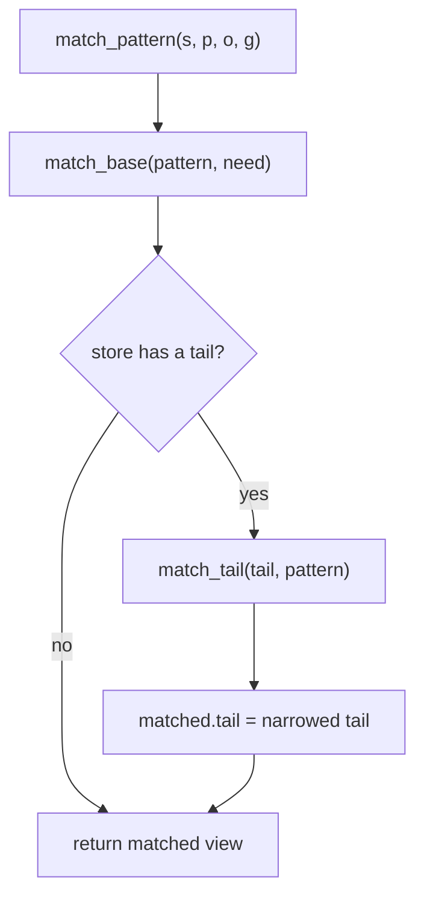
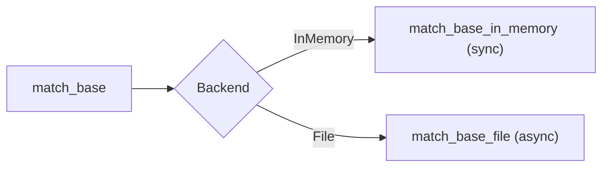
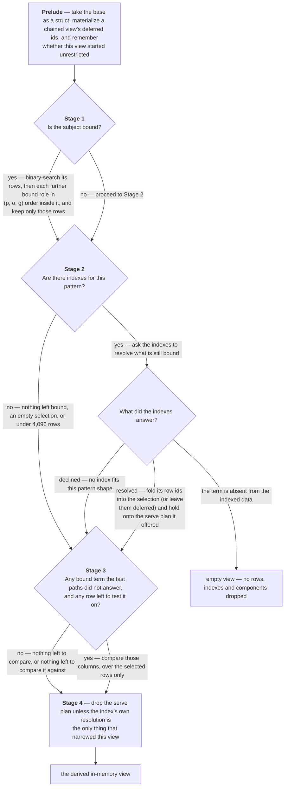
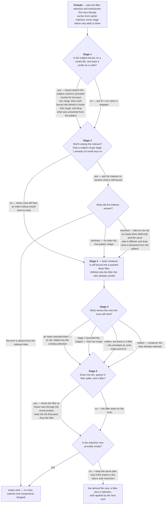
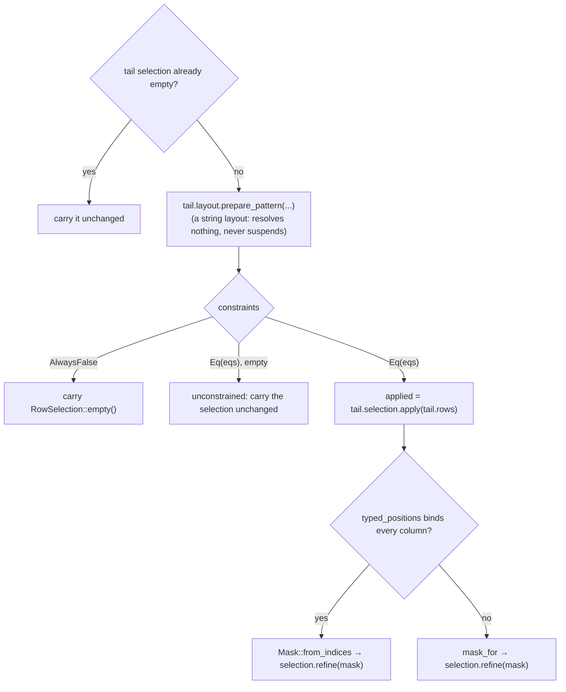

# How a quad pattern is resolved

This document traces what actually runs when a caller asks
[`VortexRdfStore::match_pattern`](../core/src/store/query/matching.rs) for the quads
matching a `(subject, predicate, object, graph)` pattern — every stage, every
decision point, and how the answer changes with the pattern shape, the storage
backend (in memory or file), the column layout, the secondary indexes present,
and the state of the append tail (see [file-format.md](./file-format.md) for more details of the data structure). Every stage is illustrated on one small
store ([§1.1](#11-the-running-example)); how the paths' costs scale is in
[§14](#14-what-each-path-costs), and how to watch a match make its decisions
in [§15](#15-watching-a-match-happen).

---

## 1. What a match produces

`match_pattern` **materializes no rows**. It returns another
`VortexRdfStore` — a *derived view* over the same base data, carrying the
restrictions the pattern implies (what a file match reads to compose them is
in [§7](#7-the-file-path)):

| Backend | Restrictions a match can compose |
|---|---|
| In memory | a `RowSelection` over base row ids (`All` / `Range` / `Ids`), plus an optional serve plan |
| File | a pushed-down filter `Expression`, a `RowSelection` over file row ids, plus an optional serve plan |

Everything a view names is a **base row id** (i.e., row positions in the base quad columns). That is
what lets secondary indexes (whose `rid` columns address base rows) survive a
match, and what lets matches be chained.

Three pieces of vocabulary recur below:

- **`RowSelection`** ([`selection.rs`](../core/src/store/view/selection.rs)) — `All`,
  a contiguous `Range`, or an ascending unique `Ids` list. A range and an id
  list are mutually exclusive by construction.
- **`ViewSelection`** — `Exact(RowSelection)` or `Pending(LazyRowIds)`. Pending
  means an index resolved the match but the exact ids were never computed,
  because a serve plan answers reads without them.
- **Serve plan** ([`indexes/serve.rs`](../core/src/store/indexes/serve.rs) in
  memory, `FileServePlan` in
  [`indexes/file.rs`](../core/src/store/indexes/file.rs) on file) — the
  matched quads read straight out of the answering index's own columns (a
  contiguous run) instead of gathering the primary columns at scattered row
  ids. Purely an optimization; the row ids alone are always sufficient.

### 1.1 The running example

The examples in this document all match against the four-quad store of
[file-format.md §7](file-format.md#7-a-worked-example):

```turtle
@prefix ex: <http://example.org/> .
@prefix foaf: <http://xmlns.com/foaf/0.1/> .
@prefix rdf: <http://www.w3.org/1999/02/22-rdf-syntax-ns#> .

ex:alice a foaf:Person ;
   foaf:name "Alice" .

ex:bob a foaf:Person ;
   foaf:knows ex:alice .
```

In `(s, p, o, g)` order — the order every builder writes — its base rows are:

| row | s | p | o | g |
|---|---|---|---|---|
| 0 | `ex:alice` | `rdf:type` | `foaf:Person` | `""` |
| 1 | `ex:alice` | `foaf:name` | `"Alice"` | `""` |
| 2 | `ex:bob` | `rdf:type` | `foaf:Person` | `""` |
| 3 | `ex:bob` | `foaf:knows` | `ex:alice` | `""` |

Terms are written in their prefixed form throughout; the string layouts store
and compare the full N-Triples term (`<http://example.org/alice>`), and `""` is
the default graph.

Under the `Dictionary` layout every column holds the term's
position in the sorted dictionary instead, and the examples quote those codes
wherever a probe value is one:

| code | term |
|---|---|
| 0 | `""` |
| 1 | `"Alice"` |
| 2 | `ex:alice` |
| 3 | `ex:bob` |
| 4 | `rdf:type` |
| 5 | `foaf:Person` |
| 6 | `foaf:knows` |
| 7 | `foaf:name` |

Row 0 in the base quads is then encoded as: `2 4 5 0`.

Patterns are written as four slots with `?` for unbound: `(ex:alice ? ? ?)`,
`(? a foaf:Person ?)`, `(ex:bob foaf:knows ex:alice "")`. In the predicate slot
`a` is Turtle's keyword for `rdf:type` (code 4). Row ids are base row ids,
and a range `[lo, hi)` excludes `hi`.

---

## 2. Top level: *base* and *tail* are matched independently



The tail branch runs **even when the base short-circuited to an empty view**.
Under the Dictionary layout the base's dictionary is frozen at construction,
so a term it has never seen may still have been appended since.

**Example.** After `add_quad(ex:carol a foaf:Person "")` on the Dictionary
store, `(ex:carol ? ? ?)` won't find `ex:carol` — the base returns an empty view (see [stage B](#4-stage-b--the-provable-emptiness-gate))
— and the tail, which holds the new quad, still matches its one
row: the result is that row. [§9](#9-the-tail) walks the tail side.

---

## 3. Stage A — `prepare_pattern`

Every match begins with
[`ResolvedLayout::prepare_pattern`](../core/src/store/layouts/mod.rs), which
returns a `PatternCodes` **witness** — the object every later stage probes for a
term's column value. All three layouts produce one; only `Dictionary` does any
work to build it. This is the single point in a match where a dictionary may
perform I/O, and the only reason the prelude is async at all.

| Layout | Residency | What the prelude does | Probe value |
|---|---|---|---|
| `Default` | — | nothing: the witness only holds the layout (never suspends) | the N-Triples string |
| `TypedObject` | — | nothing: the witness only holds the layout (never suspends) | the N-Triples string; the object decomposes into `o_kind`/`o_value`/`o_datatype`/`o_lang` |
| `Dictionary` | in-memory | seeds the role cache by in-memory binary search | `u64` code |
| `Dictionary` | file-backed | one window search of the mapped dictionary child per bound role, all **concurrent** (`join_all`), seeding every bound role | `u64` code |

What the witness saves is likewise layout-dependent. Its **role cache holds
codes**, so under `Dictionary` a fully-bound pattern costs one dictionary search
per term however many stages and indexes ask for the same probe. The string
layouts have no code to cache: each probe re-renders the term's N-Triples form,
into a scratch buffer the witness owns so the render does not allocate.

`PatternCodes::constraints(...)` lowers the pattern into per-column equalities —
shared by both the in-memory mask scan and the pushed-down
file filter. **Only bound roles emit an equality**. The right-hand side of
each equality is the layout's probe value: the rendered N-Triples string for the
string layouts, the dictionary code for `Dictionary`.

**Example.** For `(ex:alice ? "Alice" ?)` — subject and object bound, predicate
and graph free — the prelude resolves what is bound and exists, and the equalities come out
as:

| Layout | What the prelude resolves | Emitted equalities |
|---|---|---|
| `Default` | nothing | `s = "<http://example.org/alice>"`, `o = "\"Alice\""` |
| `TypedObject` | nothing | `s = "<http://example.org/alice>"`, `o_kind = 2u8`, `o_value = "Alice"` |
| `Dictionary` | `s → 2`, `o → 1` — two binary searches of the dictionary | `s = 2u64`, `o = 1u64` |

The string layouts compare one column per bound role; `TypedObject` is the
exception, expanding a bound object into the 2–4 sub-column equalities its
decomposition implies — `"Alice"@en` would add `o_lang = "en"`, a typed
literal `o_datatype`. `Dictionary` compares `u64` codes, and short-circuits the
whole pattern to **`Constraints::AlwaysFalse`** the moment any bound term is
absent from the dictionary: for `(ex:carol ? ? ?)` the subject resolves to no
code, and nothing below ever runs.

---

## 4. Stage B — the provable-emptiness gate

```rust
if codes.provably_empty(pattern) {
    return Ok(self.empty_view());
}
```

Only the Dictionary layout can reach this: a term missing from the dictionary
cannot match any base row. `empty_view()` returns a view selecting nothing, with its indexes and components dropped (so a chained match on it runs no pointless lookups).

`provably_empty` reads the prelude-seeded role cache (`roles[r] == Some(None)`)
rather than compiling `Constraints` just to test for `AlwaysFalse`: the string
layouts answer `false` without touching it, and every stage below compiles its
own constraints over whatever the fast paths leave residual.

The string layouts (`Default`, `TypedObject`) never prove emptiness here; an
unknown term simply matches zero rows later on.

**Example.** `(ex:carol ? ? ?)` on the Dictionary store ends here on either
backend: `ex:carol` has no code, and the empty view comes back
without a search, an index lookup or a scan. On a
`Default` store the same pattern is not provably empty: the subject search of
stage 1 finds the empty run `[4, 4)` (`ex:carol` sorts after `ex:bob`), and the
later stages see an empty selection and skip.

---

## 5. Stage C — backend dispatch

Here it is decided **where the base rows live**. `match_base` matches on the
[`Backend`](../core/src/store/view/mod.rs#L59) of the store's
[`QuadsSource`](../core/src/store/view/mod.rs#L43) and hands that backend's
base and the prelude's witness to the matching backend. `InMemory` holds the
base array (and any index components) resident (i.e., loaded into RAM), so its stages narrow a
`RowSelection` directly and run synchronously. `File` leaves the rows on disk,
so its stages can only *define* a filter and a selection for the next scan
([§7](#7-the-file-path)), and the arm is async because its chunk probes and
index locates may fetch segments.



---

## 6. The in-memory path

[`match_base_in_memory`](../core/src/store/query/matching.rs#L199) runs four stages
over the base `StructArray`. Each one asks the same two questions — *can I answer
part of this pattern cheaply?* and *which rows survive?* — narrowing the shared
`RowSelection` and clearing whatever pattern components it answered, so the next
stage only sees what is left.

Only the *struct* is canonical. Its columns stay in the compressed encodings
every in-memory construction gives them
([`adopt`](../core/src/store/construct.rs#L120)), and the stages below
search them in place through the cached encoded-search probes. No stage
decompresses a column; a match decodes nothing but the rows a mask scan has to
compare ([§6.3](#63-residual-column-filtering)).



Each stage in the code, and where the details are below:

| Stage | Code | Details |
|---|---|---|
| Prelude | [`matching.rs:207-232`](../core/src/store/query/matching.rs#L207-L232 "MemoryBase") | — |
| 1 · prefix probe | [`prefix_probe`](../core/src/store/query/matching.rs#L342), [`search_sorted_bounds`](../core/src/store/array.rs#L174) | [§6.1](#61-prefix-probe) |
| 2 · secondary-index routing | [`matching.rs:236-289`](../core/src/store/query/matching.rs#L236-L289 "Secondary-index routing"), [`resolve_indexes_in_memory`](../core/src/store/indexes/mod.rs#L666), [`fold_row_ids`](../core/src/store/query/matching.rs#L795) | [§6.2](#62-secondary-index-routing) |
| 3 · residual column filtering | [`matching.rs:291-308`](../core/src/store/query/matching.rs#L291-L308 "residual column filtering"), [`residual_narrow`](../core/src/store/query/matching.rs#L439), [`typed_residual_ids`](../core/src/store/scan/typed_eq.rs#L249), [`mask_for`](../core/src/store/query/matching.rs#L744) | [§6.3](#63-residual-column-filtering) |
| 4 · finalize | [`matching.rs:310-317`](../core/src/store/query/matching.rs#L310-L317 "Keep the serving plan") | [§6.4](#64-keeping-or-dropping-the-serve-plan) |

### 6.1 Prefix probe

Engages when the subject is bound **and** the base's `s` column carries the
`IsSorted` stamp. The stamp witnesses more than the subject column's order: the
rows are in global `(s, p, o, g)` order — nothing this crate writes lacks it:
every builder sorts, a tombstoned gather preserves the order it inherits, and a
rebuild that merges an append tail re-establishes it
([`sorted_live_raw_quads`](../core/src/store/write/compaction.rs)). So the stage is skipped
only for rows that arrived without the provenance — a foreign writer's file,
whose `quads_sorted: false` keeps
[`with_subject_stamp`](../core/src/store/array.rs#L103) from inventing a stamp
those rows never earned. Compacting such a store restores the fast path.

When it engages, the **subject** resolves to its exact `[lo, hi)` run in
`O(log n)`:

- through the store's **cached encoded-search probe**
  (`probes.by_name(base, "s")`) when the column resolves one and the probe value
  is an integer — the Dictionary layout's code column;
- otherwise through the per-call
  [`search_sorted_bounds`](../core/src/store/array.rs#L174), which also handles the
  string layouts' `VarBinView` subject columns.

Then the **roles behind it narrow the run in sort order** — `p` inside the
subject's run, `o` inside that, `g` inside that — each by a windowed binary
search (`bounds_in`, which consults only the window's order: a sub-run of the
sorted base is sorted by its next key) through the cached probe of that column.
The prefix ends at the first role that is unbound, or that has no code or
cached probe (the string layouts stop after the subject; a chained view whose
selection is an id list rather than a range has no window to search). Every
answered role is cleared from the pattern; whatever is still bound falls to
the stages below. So `S???`, `SP??`, `SPO?` and `SPOG` each become one exact
`Range` with nothing residual, while `S?O?` narrows by the subject and leaves
`o` to stage 3.

Unlike its file counterpart, the in-memory subject fast path works under
**every** layout; the deeper prefix needs the Dictionary layout's code
columns.

**Examples** (Dictionary layout; the subject searches the `s` column, every
further role only the run the previous one left):

| Pattern | Subject search | Roles behind it | Leaves |
|---|---|---|---|
| `(ex:alice ? ? ?)` | `s = 2` → `[0, 2)` | `p` unbound — the prefix ends | `Range [0, 2)`, nothing residual |
| `(ex:alice a ? ?)` | `[0, 2)` | `p = 4` within `[0, 2)` → `[0, 1)` | `Range [0, 1)` |
| `(ex:bob foaf:knows ex:alice "")` | `s = 3` → `[2, 4)` | `p = 6` → `[3, 4)`; `o = 2` → `[3, 4)`; `g = 0` → `[3, 4)` | `Range [3, 4)` — what `contains` runs |
| `(ex:alice foaf:knows ? ?)` | `[0, 2)` | `p = 6` within `[0, 2)` → empty: `foaf:knows` exists, but not under `ex:alice` | an empty range; stages 2 and 3 skip |
| `(ex:alice ? "Alice" ?)` | `[0, 2)` | `p` unbound — `o` is not consulted, the probe cannot skip a role | `Range [0, 2)` with `o` still bound, for [stage 3](#63-residual-column-filtering) |

Under `Default` or `TypedObject`, `(ex:alice a ? ?)` still finds `[0, 2)` —
through `search_sorted_bounds` on the string column — but `p` stays bound and
stage 3 compares it over those two rows.

**Cost.** A prefix-answered match is a fixed handful of binary searches, so it
does not grow with the run it finds. The string layouts pay a per-call search
instead of a cached probe, plus a compare over the run per residual role.

### 6.2 Secondary-index routing

Each index's `choose` **declines any pattern with a bound subject** — the
sorted `s` column is the better access path — so this stage only ever answers
predicate/object shapes.

The gate `worth_indexing = !prefix_narrowed || selection.len() >= 4096`
(`INDEX_ROUTING_MIN_ROWS`) exists because an index lookup costs
`O(rows matching that component)` regardless of how few rows the view still
holds. Once the subject search has cut the view to a handful of rows, filtering
those rows column-wise is cheaper. Nothing is lost by skipping: a view narrowed
by something else discards any serving plan anyway.

Note the disjunction: `prefix_narrowed` is **stage 1's answer** — whether a
subject search narrowed the view — so the row count is consulted only after a
successful subject search. A pattern with no bound subject never runs stage 1,
and so reaches the indexes whatever the view's size — chained or not.

That leaves one case for the count to guard, and it is the reason the stage
sees such patterns at all: stage 1 clears `pat.subject` when it succeeds, so an
`s`-and-`p`-bound pattern arrives here as a bare predicate the indexes *would*
resolve — at a cost proportional to every row carrying that predicate, to
narrow a view the binary search has already cut to a handful of rows. Below the
threshold, filtering those rows in stage 3 is cheaper. Two further guards sit
beside `worth_indexing`: the selection must still be non-empty, and something
must still be bound (`pat.any_bound()`) — a pattern the prefix probe answered
in full leaves the indexes nothing to resolve, so they are never consulted.

`resolve_indexes_in_memory` tries the store's indexes **in preference order**
(`SecondaryByCopy` before `SecondaryByReference`; the in-memory index set is
taken from `ALL_INDEX_TYPES` in that order) and takes the first that does not
decline. It answers with one of three resolutions:

| `IndexResolution` | Meaning | What the stage does |
|---|---|---|
| `Empty` | the probed term is absent from the index's data | returns `empty_view()` immediately |
| `Declined` | no index accelerates this pattern shape | nothing; the residual falls to stage 3 |
| `Resolved` | exact base row ids, plus the components they answer and an optional serve plan | clears those components from the pattern and folds the ids in |

In memory the resolver answers `Lazy` ids for both indexes: the run's slice
of the `rid` column, decoded and sorted only when a consumer needs them. They
stay **uncomputed** — becoming the view's `Pending` selection — only when that
resolution is this view's sole restriction (the view started as `All`, no
subject search narrowed it, nothing is left bound) and either a serve plan
came with it or the caller only counts or windows the view (`count_many`, a
windowed `match_many` probe: `IdsNeed::CountOrWindow`). Reads then go through
the plan, and a count takes the run's width. In every other case the ids are
materialized and intersected immediately.

**Examples** (what each index holds for the running example is laid out
where the index is described: [§8.2](#82-secondarybycopy--two-sorted-quad-copies)
for the sorted copies, [§8.3](#83-secondarybyreference--sorted-val-rid-pairs)
for the `{val, rid}` pairs).

| Pattern | With `SecondaryByCopy` | With `SecondaryByReference` |
|---|---|---|
| `(? a ? ?)` | `choose` picks the POSG family; `p = 4` bounds `index:posg` to `[0, 2)` (rids `0, 2`) → `Resolved`, `Lazy` rids, plan over that run. The view started `All`, stage 1 never ran, nothing is left bound → the ids stay **pending** and the plan is kept | `ref-p`, `val = 4` → `[0, 2)` → `Lazy` rids, no plan → materialized and sorted now → selection `Ids [0, 2]` |
| `(? a foaf:Person ?)` | the `(p, o)` prefix: `p = 4` → `[0, 2)`, then `o = 5` within it → `[0, 2)`; both components resolved, nothing residual | the object is preferred: `ref-o`, `val = 5` → `[2, 4)` → rids `[0, 2]`; `p` stays bound, and stage 3 tests it on those two rows |
| `(? ? ? "")` | no family sorts by `g` → `Declined`; stage 3 scans `g` | same |
| `(? a ? "")` | `p` resolves as above, but `g` is still bound — the lazy ids materialize now (`[0, 2]`), stage 3 tests `g` on them, and stage 4 drops the plan | `ref-p` → `[0, 2]`, stage 3 tests `g` |
| `(ex:alice ? "Alice" ?)` | stage 1 cut the view to 2 rows, under `INDEX_ROUTING_MIN_ROWS` → routing skipped (`worth_indexing` is false); on the 1M store a subject run is 10 rows, so the same | same |
| `(? ? "Carol" ?)`, `Default` layout | the dictionary cannot prove absence, the index can: the `index:ospg` run for `"Carol"` is empty → `Empty` → empty view | `ref-o` run empty → `Empty` |

**Cost.** A by-copy resolution slices its run's rids without decoding them,
whatever the run's width. A by-reference resolution read by `match_pattern`
decodes and sorts its rids at match time, in proportion to the run. Without
an index the same shapes fall to stage 3's scan of the column.

### 6.3 Residual column filtering

Whatever no fast path answered is compiled to constraints ([§3](#3-stage-a--prepare_pattern))
and compared column-wise, over **only the rows the view still selects**. The
compile can in principle answer `AlwaysFalse` — an empty view — but not here:
the residual binds a subset of roles the [stage B gate](#4-stage-b--the-provable-emptiness-gate)
already resolved, so that arm exists for totality. Two implementations, in
order:

1. **Typed residual** ([`scan/typed_eq.rs`](../core/src/store/scan/typed_eq.rs))
   — a direct row loop yielding exact base ids, no slice/compare/mask pipeline.
   It binds each residual equality to a typed column view:
   - canonical non-nullable `u64` code primitives → slice loads (and, when
     every constraint is a code compare, a branch-free `(&[u64], u64)` loop);
   - other non-nullable unsigned ints whose encoding resolves an encoded-search
     probe → per-row point reads, through the probe the store resolved for its
     base column (`StructProbes`), so a match resolves none;
   - canonical non-nullable Utf8 `VarBinView` → length-first view-level compare.

   It **declines** when any column is nullable or unsupported, when a lone
   constraint faces a wide selection (`> 4096` rows — SIMD wins there), or when
   a probe-bound (wire-encoded) column faces a wide selection.

2. **Mask scan** (`mask_for`) — the general vectorized fallback: take the
   gathered rows as a struct (again only the struct, not its columns),
   broadcast each probe to a `ConstantArray`, `Eq`-compare per column, `And`
   them together, then `RowSelection::refine` translates the positional mask
   back into base row ids. Each `Eq` kernel decides for itself how much of its
   column it has to decode, and it sees only the gathered rows.

The whole stage is skipped unless **both** halves of its gate hold: some term
is still bound (stages 1 and 2 clear the components they answer, so a pattern
they fully resolved arrives with nothing to compare) and the selection is still
non-empty (nothing to compare it against). Skipping on the first half is a real
saving, not just a formality: `mask_for` would return `None` without reading a
row, but its arguments — `selection.apply` through the array optimizer, plus a
struct canonicalization — are exactly the per-call cost the gate avoids.

> **Tombstones are deliberately not consulted here.** Every read path applies
> them instead, so a match may name deleted rows without any result showing
> them. Keeping them out also keeps the mask scan's positions aligned with
> `selection.apply`, which is what `refine` maps back through.

**Examples** (no index unless stated):

| Pattern | Residual | Selection on entry | Which implementation | Result |
|---|---|---|---|---|
| `(ex:alice ? "Alice" ?)` | `o = 1` | `Range [0, 2)` from stage 1 | typed: one equality over 2 rows (≤ 4,096) | row 0 has `o = 5`, row 1 has `o = 1` → `Ids [1]` |
| `(? ? ? "")` | `g = 0` | `All` (4 rows) | typed: 4 rows are under the gate | `Ids [0, 1, 2, 3]` |
| `(? a foaf:Person ?)`, `SecondaryByReference` | `p = 4` — the index answered `o` | `Ids [0, 2]` | typed | both hold → `Ids [0, 2]` |
| `(ex:alice a ? ?)`, `Default` layout | `p = "<…#type>"` | `Range [0, 2)` | typed: a `VarBinView` compare, length first | `Ids [0]` |
| `(? p0 ? ?)` on the 1M store | `p = code` | `All` (1,048,576 rows) | **mask scan** — a lone equality over a wide selection declines the typed loop | 31,776 ids |
| `(? p0 o0 ?)` on the 1M store | `p = code`, `o = code` | `All` | typed: two code columns, the branch-free loop | 1 id |
| `(? ? o0 ?)` on the 1M store, `TypedObject` | `o_kind = 2u8`, `o_value = "…"` | `All` | mask scan — the `u8` column binds only through a probe, which declines over a wide selection | 2 ids |

**Cost.** Both implementations read every selected row, so a wide residual is
the one stage whose cost tracks the store, not the result; a string column
costs more per row than a code column. A narrow residual behind a subject run
compares a handful of rows.

### 6.4 Keeping (or dropping) the serve plan

A serving plan describes a contiguous run of the index's own columns. It is only
valid when that run **is** the whole result, so it survives only if:

```
unrefined (the view started as All)  AND  nothing else narrowed the view
```

Deferred (`Pending`) ids are kept under a strictly stronger condition, which
stage 2 checks as it folds them: additionally nothing may be left bound, and
either the plan came with them or the caller only counts or windows the view
([§6.2](#62-secondary-index-routing)). So a pending selection rides with a
plan, except on a view built to be counted or windowed.

**Examples** (`SecondaryByCopy`): `(? a ? ?)` keeps its plan — the view
started `All` and only the index narrowed it — and its ids stay pending, so
`size()` answers from the run's width and `quads()` reads `index:posg[0, 2)`
without ever computing `[0, 2]`. `(? a ? "")` loses it: stage 3 ran
for `g`, so `residual_narrowed` is set. `(ex:alice a ? ?)` never had one —
the prefix probe answered, and the indexes were not consulted. A second match
on the `(? a ? ?)` view loses it too, however it resolves: the view no
longer starts `All` ([§11](#11-chained-matches)).

---

## 7. The file path

[`match_base_file`](../core/src/store/query/matching.rs#L495) composes the same
restrictions as the in-memory path, but **leaves the rows to the next scan**:
each stage decides what that scan will do, and the result is a filter
expression plus a row selection. The match itself reads only what those
decisions need: the chunk probes that locate a bound subject's run, what an
index resolution reads (its run's location, and its ids unless they stay
deferred), a chained view's pending ids, the zone-map statistics that prune,
and stage 5's point reads.



Each stage in the code, and where the details are below:

| Stage | Code | Details |
|---|---|---|
| Prelude | [`matching.rs:503-508`](../core/src/store/query/matching.rs#L503-L508 "FileBase") | — |
| 1 · subject chunk probe and prefix | [`matching.rs:509-516`](../core/src/store/query/matching.rs#L509-L516 "A bound subject on a sorted file"), [`locate_subject`](../core/src/store/query/matching.rs#L688), [`locate_subject_run`](../core/src/store/scan/file_reads.rs#L362), [`narrow_subject_run`](../core/src/store/scan/file_reads.rs#L391) | [§7.1](#71-subject-chunk-probe) |
| 2 · secondary-index routing | [`matching.rs:517-530`](../core/src/store/query/matching.rs#L517-L530 "With the subject already resolved"), [`resolve_indexes_file`](../core/src/store/indexes/mod.rs#L691) | [§8](#8-the-index-resolvers) |
| 3 · pushed-down filter | [`matching.rs:543-613`](../core/src/store/query/matching.rs#L543-L613 "match resolution"), [`build_file_filter`](../core/src/store/scan/file_reads.rs#L333) | [§7.3](#73-what-ends-up-on-the-view) |
| 4 · selection and serve plan | [`matching.rs:536-537`](../core/src/store/query/matching.rs#L536-L537 "keep_serve"), [`fold_row_ids`](../core/src/store/query/matching.rs#L795) and [`matching.rs:621-635`](../core/src/store/query/matching.rs#L621-L635 "match resolved_selection"), [`prune_by_filter`](../core/src/store/query/matching.rs#L717), [`row_range_from_pruning`](../core/src/store/scan/file_filter.rs#L413) | [§7.2](#72-zone-map-pruning), [§7.3](#73-what-ends-up-on-the-view) |
| 5 · filter at sparse ids | [`matching.rs:637-652`](../core/src/store/query/matching.rs#L637-L652 "Exact ids sparse in their splits"), [`point_filter_ids`](../core/src/store/scan/file_reads.rs#L707) | [§7.3](#73-what-ends-up-on-the-view) |

The two paths differ in what a stage produces, not in what it asks. In memory a
stage narrows a `RowSelection` directly; here stage 3 can only *describe* the
residual as a filter, and stage 4 turns whatever remains into row bounds the
scan can honour, from statistics alone. Stage 5 is the one that tests the
filter before the scan: exact ids sparse in their splits check it at their own
rows, point by point, because the scan's filter evaluation decodes every row of
each split they touch.

### 7.1 Subject chunk probe

The file mirror of the in-memory subject binary search
([`locate_subject_run`](../core/src/store/scan/file_reads.rs#L362)): it
binary-searches the subject column's **encoded chunks** through cached chunk
probes, reading only the chunks the bisection touches. It requires `u64::try_from(&probe)` to succeed, so
it engages **only under the Dictionary layout** — a string-subject file falls
through to zone-map pruning.

It also declines for a missing chunk handle, an unsupported chunk encoding, or a
file whose `quads_sorted` provenance is false — which, as in
[§6.1](#61-prefix-probe), no writer of ours produces. Each index's `choose`
declines bound-subject patterns, so this fast path takes an uncontested route.

Then, as the in-memory prefix probe does, it narrows the run by the roles
behind the subject in sort order
([`narrow_subject_run`](../core/src/store/scan/file_reads.rs#L391)): each bound
role whose term has a code is binary-searched inside the run through its
column's chunk probes (`ColumnChunks::bounds_in`) and leaves the pattern. The
first role that is unbound, has no code or whose chunks decline ends the
prefix, and whatever is still bound rides the narrowed range as filter
conjuncts.

**Examples** (Dictionary file): `(ex:alice ? ? ?)` bisects the subject column's
chunks for `s = 2` and finds `[0, 2)`; the view carries that range and no
filter. `(ex:alice a ? ?)` then searches `p = 4` inside it and carries `[0, 1)`
with no filter, as the in-memory path does. `(ex:alice foaf:knows ? ?)`
narrows to an empty range at match time. `(ex:alice ? "Alice" ?)` stops at the
unbound predicate: it carries `[0, 2)` plus `o = 1` as a filter.

**Cost.** A handful of binary searches over the chunks' last values and the
leaves they reach, and one more search inside the run per answered role. The first probe of a freshly opened file rebuilds the leaves it
bisects; the column's handle keeps them for later probes
([file-format.md §8](file-format.md#8-reading-a-file)).

### 7.2 Zone-map pruning

When no index resolved anything and no subject range was found,
[`row_range_from_pruning`](../core/src/store/scan/file_filter.rs#L413) runs one
`pruning_evaluation` per filter conjunct over the whole file — statistics only,
no row data — stopping at the first conjunct that leaves no row (the conjuncts
after it are never bound), and collapses the surviving mask to its enclosing
contiguous range. Interior gaps are kept (the scan's own per-split pruning skips them from
the same cached zone masks); only outer dead space is trimmed. The envelope is
memoized on the shared file handle, keyed by the filter expression.

Results: `Some(0..0)` when nothing can match, `None` when statistics exclude
nothing.

**Example.** `(? a ? ?)` on the Dictionary file without indexes pushes
`p = 4` down. The four-row file is one zone whose `p` statistics span `4..7`,
so nothing is excluded: the result is `None`, the selection stays `All`, and
the filter waits for the read. On the 1M file (128 zones of 8,192 rows) the
predicate `p0` occurs every 33 rows, so every zone keeps it (the log says
`range: false`) and the read evaluates the filter over the whole file.
`(? ? o0 ?)` matches two rows whose object the statistics of most zones rule
out, so pruning collapses the scan to the zones that can hold it
(`range: true`). Pruning matters most where the subject cannot be bisected: a
`Default` file's `(s0 ? ? ?)` has no chunk probe (string subject), but
subjects are sorted, so every zone's statistics but one exclude `s0` and the
read touches one zone rather than the file.

### 7.3 What ends up on the view

- **Filter** — the residual pattern, ANDed onto whatever earlier matches left.
  Components an index resolved are *excluded*: the row ids already are exactly
  their matches, so re-filtering would only re-read and re-compare that column.
  When the selection is exact row ids at most one per `POINT_READ_ROWS` (256)
  rows of the splits holding them, stage 5 reads the filter's columns at those
  ids through the chunk probes, keeps the ids that pass and leaves no filter
  ([`point_filter_ids`](../core/src/store/scan/file_reads.rs#L707)) — the
  in-memory residual step ([§6.3](#63-residual-column-filtering)) on file. A
  denser selection, or a filter that is not code equalities, keeps the filter.
- **Selection** — the first of these that applies: an index's row ids folded
  into what the view already selected, stage 1's subject range, the envelope
  zone-map pruning collapses the filter to, or the selection the view arrived
  with. An index's ids stay **`Pending`** — never computed — when the serve
  plan below survives, because the plan answers reads without them, and when
  the caller only counts or windows the view (`IdsNeed::CountOrWindow`) and
  the ids cover a located run with nothing residual on an otherwise
  unrestricted view, because the run's width is the count; in every other
  case they materialize here.
- **Serve plan** — kept only when this match is the view's sole restriction: no
  filter carried in, the incoming selection was `All`, and stage 1 found no
  subject range. The plan reads a contiguous run of the index's own columns,
  which stops being exactly the result the moment anything else narrows the
  view.
- **Tombstones** — a property of the file, not the pattern; they carry across
  unchanged and every read path applies them.

An `Exact` selection that is provably empty normalizes to `empty_view()` before
the view is built. A `Pending` one is left alone: its coverage is unknown by
design, and it may still materialize to nothing later, which every consumer
handles like any other narrow selection.

**Examples** — what the view holds after a match on the Dictionary file with
`SecondaryByCopy`:

| Pattern | Filter | Selection | Serve plan |
|---|---|---|---|
| `(ex:alice ? ? ?)` | none | `Range [0, 2)` from the chunk probe | none (a subject range) |
| `(ex:alice a ? ?)` | none — the prefix answered `p` | `Range [0, 1)` | none |
| `(? a ? ?)` | none — the index answered `p` | `Ids [0, 2]`, **eager**: the located run is 2 rows, under `POINT_GATHER_MAX_ROWS`. On the 1M file `P`'s run is 31,776 rows and the ids stay `Pending` | over the `index:posg` run |
| `(? a ? "")` | `g = 0` | `Ids [0, 2]` | **kept** — on file the plan carries the `g` equality itself; the in-memory twin drops it |
| `(? ? ? "")` | `g = 0` | `All` — pruning excluded nothing | none |
| `(? ? foaf:Person ?)` then `(? a ? ?)` on that view | `p = 4` ANDed onto nothing | the second match's `Ids [0, 2]` intersected into the first's | dropped: `existing_selection` was no longer `All` |

---

## 8. The index resolvers

Each index chooses what to probe for a pattern — an `IndexProbe`: the child,
the sort keys and terms to search, the roles a hit resolves, any residual
terms, whether the child serves reads, and whether a run's rids ascend — and
one resolver per backend executes every index's probe
([`resolve.rs`](../core/src/store/indexes/resolve.rs) in memory,
[`file.rs`](../core/src/store/indexes/file.rs) on file). Both answer in one
shared currency: `IndexResolution` — `Declined`, `Empty`, or
`Resolved { row_ids, resolves, serve }`, where `row_ids` are ascending unique
**base** row ids.

### 8.1 Which index handles which shape

`choose()` in each index module, independent of backend:

| Pattern (s, p, o) | `SecondaryByCopy` | `SecondaryByReference` |
|---|---|---|
| subject bound (any shape) | **declines** | **declines** |
| `p` bound, `o` bound | `index:posg`, `(p, o)` prefix probe → resolves **PredicateObject** | `index:ref-o` on the object → resolves **Object** |
| `p` bound only | `index:posg` lead probe → resolves **Predicate** | `index:ref-p` → resolves **Predicate** |
| `o` bound only | `index:ospg` lead probe → resolves **Object** | `index:ref-o` → resolves **Object** |
| neither bound | **declines** | **declines** |

A bound **graph** never routes: neither index sorts by it. It always stays in
the residual (a mask scan in memory, a filter conjunct on file) — except inside
a `FileServePlan`, which carries a graph equality of its own (see 8.4).

### 8.2 `SecondaryByCopy` — two sorted quad copies

Children: `index:posg` (quads sorted by p, o, s, g) and `index:ospg` (sorted by
o, s, p, g), each `{s, p, o, g, rid}`, term strings or `u64` codes.

**In memory:** requires the family's component to exist and be *globally* sorted
(`IndexComponent::find_sorted` — per-chunk sorted data is not binary-searchable).
Binary-searches the lead column for the probe run, then — for a `(p, o)` pattern
— re-searches the second key **within** that run (valid because the family's full
comparator makes the second column sorted inside each lead run). It returns:

- `Empty` if the probe term is absent from the dictionary, or the run is empty;
- `Declined` if the component is missing, unsorted, or probe-incompatible;
- otherwise `Resolved` with **`Lazy` row ids** (the rid slice, decoded and
  re-sorted only on demand) and **always a serve plan** over the matched run.

**On file:** locates the run by binary-searching the child's cached chunk probes
([`locate_component_run`](../core/src/store/indexes/file.rs#L40): lead,
then a windowed second-key search), integers only. Then:

| Located run | Row ids |
|---|---|
| empty | `IndexResolution::Empty` |
| ≤ 256 rows (`POINT_GATHER_MAX_ROWS`) | **Eager**, via [`rid_point_reads`](../core/src/store/indexes/file.rs#L71) |
| wider, or unlocated | **Lazy** — a deferred rid-only pushed-down scan |

The serve plan is built from *every* bound non-subject component (p, o, **g**).
Its `row_range` is kept only when the graph is unbound, since the location
searched sort keys only. A bound residual term with no dictionary code matches
nothing, so the resolution is `Empty`.

**Example.** `(? a ? ?)`: the lead probe `p = 4` on `index:posg` — rows
`(2 4 5 0 · 0)`, `(3 4 5 0 · 2)`, `(3 6 2 0 · 3)`, `(2 7 1 0 · 1)` in that
order — bounds `[0, 2)`, whose `rid` column reads `0, 2`. In memory that slice
is handed back lazily with a plan over `index:posg[0, 2)`; on file the run is
located through the child's chunk probes and, being 2 rows, its rids are
point-read now (`Eager`) while the plan still serves the quads.
`(? a foaf:Person ?)` adds the windowed second search, `o = 5` inside
`[0, 2)`, and resolves both roles in one probe. `(? ? foaf:Person ?)` goes to
`index:ospg` — rids
`1, 3, 0, 2` — where `o = 5` bounds `[2, 4)`, rids `0, 2`. On the 1M file
`P`'s located run is 31,776 rows: over the point-read cap, so the ids become a
deferred rid-only pushed-down scan and reads stream the run through the plan
— a scan of exactly that row range, no filter, split by row count so that its
decode runs on many of the runtime's workers rather than inside the single
leaf-chunk split the child's own layout would make of the run.

**Cost.** Locating a run is a handful of binary searches on either backend,
whatever its width. Reading through the plan is what differs: a copy serves
a contiguous run of its own columns, where a by-reference or filter-only
match gathers the primaries at scattered ids or scans them through a filter;
narrow runs are point-read either way.

### 8.3 `SecondaryByReference` — sorted `{val, rid}` pairs

Children: `index:ref-o` and `index:ref-p`. Stores no whole quads, so it **never
supplies a serve plan**.

**In memory:** binary-search the sorted `val` column and slice the paired
`rid` run: `Lazy` ids, which `sorted_row_ids` puts back in base row order when
a consumer needs them; a count takes the run's width, and a window cuts its
own rows out of the run before decoding them (the rows of one value are in row
id order). Declines when the component is absent, unsorted, or
probe-incompatible.

**On file:** [`locate_component_run`](../core/src/store/indexes/file.rs#L40)
binary-searches the value column's chunk probes (sorted child + integer probe
required). A located run's ids are `Lazy`
([`read_located_rids`](../core/src/store/indexes/file.rs#L137)): a count
takes the run's width, a window reads only its own rows, and materialized, a
run ≤ 256 rows uses [`rid_point_reads`](../core/src/store/indexes/file.rs#L71)
and a wider one a rid-only scan restricted to the range — neither pays filter
evaluation. Anything the probes decline falls back to
[`scan_index_row_ids`](../core/src/store/indexes/file.rs#L104), an eager
pushed-down `val == probe` scan that answers whatever the order.

**Example.** For the running example `index:ref-o` holds
`(1→1) (2→3) (5→0) (5→2)` and `index:ref-p` `(4→0) (4→2) (6→3) (7→1)` —
`{val, rid}` pairs sorted by value. `(? ? foaf:Person ?)`: `val = 5` bounds `[2, 4)`
in `ref-o`, the paired rids are `0, 2`, already in base order. `(? a ? ?)`
bounds `val = 4` in `ref-p` to `[0, 2)`, rids `0, 2`. `(? a foaf:Person ?)` takes
the object's route — the preferred side — and leaves `p` for the residual
stage, which tests it on rows 0 and 2; on file that is stage 5, which reads
`p` at those rows through the chunk probes once they are sparse in their
splits. On the
1M file a `P` run of 31,776 pairs is over the point-read cap: its ids, once
needed, come from a rid-only scan of exactly that range, where `O`'s two
pairs are point-read; a count of either is its run's width.

**Cost.** The rids are decoded and sorted when a consumer needs them, and
every read is a gather of the primaries at those ids, where a copy serves a
contiguous run. The trade is size: `{val, rid}` pairs are a fraction of a
second sorted copy of every quad.

### 8.4 Serve plans, side by side

| | `InMemoryServePlan` | `FileServePlan` |
|---|---|---|
| Acquisition | slice the component's `[start, end)` run, or point-read it through cached probes when ≤ 256 rows | a located run: [`component_point_chunk`](../core/src/store/scan/file_reads.rs#L1226) point reads when ≤ 256 rows, else a projected scan of exactly its row range, split by row count across the workers ([`located_run_scan`](../core/src/store/indexes/file.rs#L513)); unlocated: the pushed-down projected+filtered scan of the index child |
| Constraints | implicit in the run's bounds (lead ± second key) | explicit `p`/`o`/`g` term equalities, bound lazily on first read |
| Dropped when | anything else narrowed the view (including a bound graph, which forces a residual scan) | an earlier filter/selection exists, or a subject range applies |
| Tombstones | applied through the plan's `rid` column | applied through the plan's `rid` column |

Both decode through the shared `ServeDecode` tail, reading the copy's
`(s, p, o, g)` columns, which carry the primary names, and decoding them through
the layout the copies store (`Dictionary` codes, else `Default` strings — even a
TypedObject store's copies decode as `Default`).

---

## 9. The tail

[`match_tail`](../core/src/store/query/matching.rs) narrows the append tail — small,
unsorted, unindexed — so a scan over its already-few selected rows is the whole
plan.



Notes:

- **`tail.layout`** is the store's own layout, except under `Dictionary`,
  where it is `Default` (`Tail::layout_for`, fixed when the tail is first
  appended): an appended term has no code in the frozen sorted
  dictionary, so the tail keeps N-Triples strings. Patterns therefore probe the
  base **by code** and the tail **by string**, with two separate witnesses.
- Because the tail's layout is always a string layout, the `AlwaysFalse` arm
  cannot fire; it is the structural counterpart of the base's gate.
- The typed path is what every `contains` — and therefore every `add_quad`
  presence check — rides: raw byte compares over the tail's string columns, no
  per-call compare/canonicalize pipeline.
- `typed_positions` accepts a flat canonical struct **or** a chunked accretion
  of them, which is the shape `add_quads` builds.

**Example.** `add_quad(ex:carol a foaf:Person "")` on the Dictionary store
with `SecondaryByCopy` first runs the presence check — a fully bound match,
which the base proves unmatchable at stage B (`ex:carol` has no code) and the
absent tail cannot answer — then appends the quad to a one-row tail of
N-Triples strings. On the resulting store:

| Pattern | Base | Tail | Rows |
|---|---|---|---|
| `(? a foaf:Person ?)` | `index:posg` prefix probe → pending ids + plan over rows `0, 2` | `p = "<…#type>"`, `o = "<…Person>"` by typed positions over 1 row → position 0 | 3 |
| `(ex:carol ? ? ?)` | provably empty | `s = "<http://example.org/carol>"` → position 0 | 1 |
| `(ex:alice ? ? ?)` | prefix probe → `Range [0, 2)` | typed positions → none | 2 |

The tail's cost is its size: a few rows compared as raw bytes, which is why a
presence check on a small tail is not visible next to the base match.

See [docs/mutations.md](mutations.md) for the tail, tombstone and compaction model.

---

## 10. Pattern-shape cheat sheet

Assuming a store built with sorted subjects and (where stated) secondary
indexes. `→` reads "then".

### 10.1 In memory

| Pattern | Dictionary layout, `SecondaryByCopy` | Dictionary layout, `SecondaryByReference` | No indexes |
|---|---|---|---|
| `????` (nothing bound) | no work: selection stays `All` | same | same |
| `S???` | prefix probe → `Range` | same | same |
| `?P??` | POSG lead probe → lazy ids **+ serve plan** | ref-p probe → lazy ids, materialized unless only counted or windowed | typed/mask scan of `p` over all rows |
| `??O?` | OSPG lead probe → lazy ids **+ serve plan** | ref-o probe → same as above | typed/mask scan of `o` |
| `?PO?` | POSG `(p, o)` prefix probe → both resolved, lazy ids **+ serve plan** | ref-o probe (object preferred) → ids → residual `p` scan | typed/mask scan of `p ∧ o` |
| `???G` | indexes decline → typed/mask scan of `g` | same | same |
| `?P?G` | POSG lead probe → residual `g` scan **drops the plan**, ids materialize | ref-p probe → residual `g` scan | typed/mask scan |
| `SP??` / `SPO?` / `SPOG` (`contains`) | prefix probe → exact `Range`, nothing residual; indexes never consulted (nothing left bound) | same | same |
| `S?O?` / `S??G` | prefix probe narrows by the subject; residual scan of `o` (or `g`) over the range — index routing skipped entirely if the range is < 4096 rows | same | same |

Under the string layouts (`Default`, `TypedObject`) the prefix probe stops after
the subject (their columns resolve no probe), so `SP??`…`SPOG` become subject
range → residual scan; the probe values change too (strings instead of codes),
and the object of a `TypedObject` store expands into 2–4 residual equalities.

### 10.2 File-backed

| Pattern | Dictionary layout, `SecondaryByCopy` | Dictionary layout, `SecondaryByReference` | No indexes |
|---|---|---|---|
| `????` | selection `All`, no filter | same | same |
| `S???` | subject chunk probe → exact `Range`, no filter | same | same |
| `?P??` | POSG located run → eager ids (≤ 256) or lazy ids **+ serve plan** | ref-p located run → lazy ids, materialized unless only counted or windowed; filter empty | filter `p = code` → pruning envelope |
| `??O?` | OSPG located run → same as above | ref-o located run → same as above | filter `o = code` → pruning envelope |
| `?PO?` | POSG `(p, o)` windowed location → both resolved, **serve plan** | ref-o located run → ids; `p` read at them by point reads when they are sparse in their splits, else the filter keeps `p` | filter `p ∧ o` → pruning envelope |
| `?POG` | as above; plan carries `g` too, but its `row_range` is dropped | ref-o ids; `p ∧ g` read at them as above, else the filter keeps them | filter `p ∧ o ∧ g` |
| `SP??` … `SPOG` | subject chunk probe, then the prefix behind it → exact `Range`, nothing residual; index routing skipped when the range is < 4096 rows | same | same |

Under the string layouts the subject chunk probe and both indexes' `locate_component_run`
decline (they need integer probes), so a file match reduces to *pushed-down
filter + zone-map pruning* — plus, for `SecondaryByCopy`, a filtered index-child
scan that still supplies a serve plan.

---

## 11. Chained matches

`match_pattern` on an already-derived view composes rather than rebases:

- In memory, a still-`Pending` selection **materializes** at the top of
  `match_base_in_memory` (`selection.materialized()`) — chaining is one of
  the consumers the deferral exists for. `unrefined` is then false, so no serve
  plan can be kept.
- On file, `existing_filter` is ANDed with the new one and `existing_selection`
  is intersected; `keep_serve` is false the moment either is non-trivial.
- The base array / file handle and the index components are **shared**, not
  rebuilt: the selection names base row ids, which no narrowing renumbers. Only
  a physical gather (compaction) invalidates them, and that rebuilds the index
  set over the new order.
- The tail's own selection is tail-local and narrows independently on each call.

**Example.** `(? a ? ?)` on the in-memory `SecondaryByCopy` store gives a
view whose ids are pending with a plan over `index:posg[0, 2)`. Calling
`match_pattern(? ? foaf:Person ?)` on that view: the pending ids materialize first
(`[0, 2]`), so `unrefined` is false; nothing narrowed the view *in this call*,
so the indexes are consulted and `index:ospg` resolves `o = 5` to rids `0, 2`
— lazily, but the deferral condition fails (`unrefined`), so they are
materialized and intersected: `Ids [0, 2]`. Stage 4 drops the plan the second
index offered. Doing the same on the file view ANDs nothing onto the filter
(both matches were answered by an index) and intersects the two id sets.

---

## 12. What the derived view costs at read time

The match's decisions show up here
([`quads.rs`](../core/src/store/read/quads.rs),
[`rows.rs`](../core/src/store/read/rows.rs),
[`count.rs`](../core/src/store/read/count.rs)):

| Consumer | With a serve plan | Without |
|---|---|---|
| `quads()` / `quads_vec()` | decode the plan's run (in memory: slice or point reads; file: point reads ≤ 256 rows, else a range scan of the located run (`located_run_scan`); a projected+filtered scan of the child only when the run was not located) — the pending ids are never touched | gather the selection from the primaries; on file, read it by id or scan it as `ExactRead` chooses (below) |
| `shared_quads_vec()` / `shared_quad_chunks()` | as `quads()`, through the plan's shared-term decode twins — one `Arc<str>` per distinct term of a chunk, handed to every row repeating it | the same gather or restricted scan, decoded to shared terms |
| `size()` | in memory a lazy component run knows its width without decoding; on file a located run's width answers outright when no filter or tombstones apply, otherwise the ids materialize (then filter masks are counted if a filter is pending) | selection length — a located reference run held for a count answers with its width — or `count_matching_rows` over the filter |
| `code_columns()` / `code_columns_gathered()` | read the four `u64` code columns straight off the index's own columns: in memory a run of at most 256 rows through its probes, on file a run whose ids are still deferred through the plan's scan ([`code_columns`](../core/src/store/indexes/file.rs#L538)) | materialize the selection, then slice/gather the base's buffers — `code_columns_gathered` runs the full read pipeline where the zero-copy path declines (file-backed or non-canonical views), on file read by id or scanned as `ExactRead` chooses, a point read filling the code buffers straight from the chunk probes |
| `raw_quad_chunks()` | plan deliberately ignored (it reorders rows): the pending ids materialize and the rows are read as without one | as `quads()`, in base row order: gathered in memory; on file read by id or scanned as `ExactRead` chooses |

An exact file selection is read the cheapest way
([`ExactRead`](../core/src/store/scan/file_reads.rs#L851)): point by point
through the chunk probes when it is point-sized, or ids at most 16 per split
they touch (`POINT_IDS_PER_SPLIT`), and every column has chunk probes;
taken at its ids when they number at most one per 16 rows of their splits
(`TAKE_ROWS`) and no filter is pending — each column from its chunk probes'
leaves, else split by split; scanned otherwise. A take runs the in-memory
gather's kernels over the wire-encoded leaves, where the scan's row mask would
filter a run-end column run by run over every split it touches.

A one-shot read (`code_columns_gathered`, `quads_vec`, `shared_quads_vec`) of a
view whose pending filter is code equalities over columns with chunk probes,
at a selection those reads decline, reads the filter's masks first
(`ExactRead::Masks`): the per-split filter loop a window runs
([§16.2](#162-window-size_capped-exists)), every split evaluated, in file order.
The rows the masks keep are then read the same way, by their density over the
splits holding them (`MaskedRead`): point by point, by one take, or, denser
than a take, each split projected at its own mask, the filter not evaluated
again. `quads_vec` and `shared_quads_vec` read and decode a take or a
projection split by split, spawning the split reads when there is more than
one and a tokio runtime is current. The streams (`quads()`, `row_chunks`,
`code_chunks`, the data source) keep the restricted scan, which reads the file
split by split as they are pulled.

`LazyRowIds` caches into a shared `OnceLock`, so the first consumer that needs
the ids pays for them once and every clone of the view reads them back for free.

**What a read costs.** Decoding rows is what a wide read pays for, per row; a
served read decodes a contiguous run of the index's columns, a gather the
primaries at scattered ids. The match in front of it is a handful of binary
searches with an index and a column scan without. `size()` on a pending view
costs nothing when the run's width is known (an in-memory run, a located
file run) and a rid-only scan of the index child otherwise.

---

## 13. Decision points at a glance

| # | Where | Condition | Consequence |
|---|---|---|---|
| 1 | `match_base` | `codes.provably_empty(pattern)` — a bound role resolved to no code | `empty_view()`, no backend work |
| 2 | in memory | `s` bound ∧ `s` stamped sorted ∧ probe casts | binary-search `[lo, hi)`; subject cleared |
| 2b | in memory | selection is a `Range` ∧ next role in (p, o, g) bound ∧ it has a code and a cached probe | `bounds_in` narrows the run; that role cleared; repeat until a role declines |
| 3 | in memory | selection non-empty ∧ something bound ∧ (`!prefix_narrowed` ∨ `len ≥ 4096`) | try index routing |
| 4 | in memory | resolution `Lazy` ∧ unrefined ∧ untouched ∧ nothing bound ∧ (plan ∨ count or window) | defer the ids (`Pending`) |
| 5 | in memory | selection non-empty ∧ something still bound | residual filtering |
| 6 | in memory | every residual column typed-bindable ∧ not (single eq over > 4096 rows) ∧ no probe-bound column over a wide selection | typed row loop, else mask scan |
| 7 | in memory | `unrefined ∧ !prefix_narrowed ∧ !residual_narrowed` | keep the serve plan |
| 8 | file | `s` bound ∧ `quads_sorted` ∧ integer probe ∧ chunk probes resolve | exact subject row range; subject cleared |
| 8b | file | subject run found ∧ next role in (p, o, g) bound ∧ it has a code and chunk probes | `bounds_in` narrows the run; that role cleared; repeat until a role declines |
| 9 | file | no subject range ∨ range ≥ 4096 rows | try index routing |
| 10 | file | no existing filter ∧ existing selection `All` ∧ no subject range | `keep_serve` |
| 11 | file | resolution `Lazy` ∧ (plan kept ∨ (count or window ∧ located width ∧ no residual ∧ unrestricted view)) | selection stays `Pending` |
| 12 | file | no index resolution ∧ no subject range ∧ filter present | zone-map pruning envelope |
| 12b | file | `Exact` ids ∧ filter of code equalities ∧ at most one id per 256 rows of their splits ∧ chunk probes resolve | filter checked at the ids by point reads; no filter left |
| 13 | file | `Exact` selection empty | `empty_view()` |
| 14 | tail | tail selection empty | carry unchanged |
| 15 | tail | no equalities | every selected tail row matches |
| 16 | tail | `typed_positions` binds every column | typed positions, else mask scan |

### Tuning constants

| Constant | Value | Defined in | Meaning |
|---|---|---|---|
| `INDEX_ROUTING_MIN_ROWS` | 4096 | [`matching.rs`](../core/src/store/query/matching.rs#L814) | an already-narrowed view below this skips index routing |
| `TYPED_EQ_MAX_ROWS` | 4096 | [`typed_eq.rs`](../core/src/store/scan/typed_eq.rs#L237) | selection size above which the typed row loop declines to the vectorized mask scan: always for a lone residual equality, and for any set that binds a column through an encoded-search probe |

The point-read thresholds (`POINT_GATHER_MAX_ROWS`, `POINT_READ_ROWS`,
`POINT_IDS_PER_SPLIT`, `TAKE_ROWS`) are in [file-format.md §11](file-format.md#11-constants).

---

## 14. What each path costs

The examples that say "the 1M store", `s0`, `p0` or `o0` use the internals
benchmarks' dataset at 1,048,576 quads: 104,858 subjects, 33 predicates,
524,291 objects, 17 named graphs, 629,199 dictionary terms. Its terms are
generated IRIs, not the running example's — `s0`, `p0` and `o0` are its first
subject, predicate and object
(`<http://data.example.org/ontology/2026/property/0000>` and the like), which
no prefixed name abbreviates — and its probe shapes match:

| Probe shape | `S` | `SP` | `SPO` | `SPOG` | `P` | `O` | `PO` | `G` |
|---|---|---|---|---|---|---|---|---|
| rows matched | 10 | 1 | 1 | 1 | 31,776 | 2 | 1 | 61,681 |

How the paths' costs scale:

- **Answering by search does not grow with the result.** The prefix probe and
  a by-copy resolution are a handful of binary searches, in memory or through
  a file's chunk probes, whatever the run's width.
- **Answering by scan grows with the rows scanned**, whatever the result, and
  a string column costs more per row than a code column.
- **By-reference pays at match time, by-copy at read time.** A by-reference
  match read row by row decodes and sorts its run's rids, and every read
  gathers the primaries at those ids; a by-copy match slices its rids, and
  reads serve the copy's contiguous run — on file through a range scan split
  by row count across the workers. Narrow runs are point-read either way.
- **Wide reads are decode-bound**: their cost is per row decoded, served or
  gathered. A run of at most `POINT_GATHER_MAX_ROWS` rows is point-read; on
  file, so are ids few per split, sparse ids are taken and the rest scanned.
- **A file adds fixed costs, not proportional ones**: the chunk probes of a
  location, a floor for any filtered scan, and on the first query after
  opening the leaves and statistics it reads.

[`core/benches/match_lazy.rs`](../core/benches/match_lazy.rs) times
`match_pattern` alone, and [`core/benches/benchmark.rs`](../core/benches/benchmark.rs)
the match plus `quads_vec()` over every matched row, on this dataset
(`BENCH_SIZE=1048576 cargo bench --bench match_lazy`); the dashboard
`scripts/refresh.sh` renders carries their figures.

---

## 15. Watching a match happen

Every stage logs the decision it took at `debug` level under its module's
target in `vortex_rdf_core`, stamped with the time since the match began. The
timers ask whether debug logging is on for the `vortex_rdf_core::debug`
target, and a stage logs only with a timer running, so a filter must enable
that module as well as the stage's: `vortex_rdf_core=debug` enables the whole
crate, while `vortex_rdf_core::store::query=debug` alone logs no stage line.
The CLI installs `env_logger`, so on the Dictionary + `SecondaryByCopy` file
of the running example:

```sh
RUST_LOG=vortex_rdf_core=debug vortex-rdf-cli match --input alice.vortex \
  --subject http://example.org/alice \
  --predicate http://www.w3.org/1999/02/22-rdf-syntax-ns#type
```

prints

```
[match_pattern] Prepared pattern codes at …
[match_pattern] File subject bounded by chunk probe at …
[match_pattern] File index declined at …
[match_pattern] File view built (filter: true, serve: false, pending ids: false) at …
```

— the prelude, the subject chunk probe finding `[0, 2)`, index routing not
taken (a subject range under 4,096 rows reports as a decline on the file
path), and a view carrying the range plus `p = 4` as a filter. Any embedder
that installs a `log` logger sees the same lines; what each one means:

| Line | Stage |
|---|---|
| `Prepared pattern codes` | [§3](#3-stage-a--prepare_pattern) — the witness is built, bound terms resolved |
| `Layout proved the pattern unmatchable` | [§4](#4-stage-b--the-provable-emptiness-gate) — a term has no code; the match ends |
| `In-memory subject bounded by binary search` / `File subject bounded by chunk probe` | [§6.1](#61-prefix-probe) / [§7.1](#71-subject-chunk-probe) |
| `File prefix of N more roles bounded by chunk probes` | [§7.1](#71-subject-chunk-probe) — `p`, `o`, `g` narrowed inside the subject run |
| `In-memory prefix of N more roles bounded by binary search` | [§6.1](#61-prefix-probe) — `p`, `o`, `g` narrowed inside the subject run |
| `… index resolved` (`eager ids` / `served, ids pending` / `ids materialized` on file), `File index located a run (ids pending for a count)`, `… index declined`, `… index proved empty` | [§6.2](#62-secondary-index-routing) / [§8](#8-the-index-resolvers) |
| `In-memory narrowed by typed residual scan` / `… by mask scan` | [§6.3](#63-residual-column-filtering) — which implementation ran |
| `File narrowed by zone-map pruning (range: …)` | [§7.2](#72-zone-map-pruning) — whether an envelope was found |
| `File filter checked by point reads` | [§7.3](#73-what-ends-up-on-the-view) — stage 5 read the filter at sparse ids |
| `File selection proved empty` | [§7.3](#73-what-ends-up-on-the-view) |
| `In-memory view built (serve, pending ids)` / `File view built (filter, serve, pending ids)` | [§6.4](#64-keeping-or-dropping-the-serve-plan) / [§7.3](#73-what-ends-up-on-the-view) — what the view carries |
| `Tail matched by typed positions` / `… by mask scan` | [§9](#9-the-tail) |

The same store in memory, timings elided:

```
(? a ? ?)                   (ex:alice ? "Alice" ?)            (? a ? "")
Prepared pattern codes      Prepared pattern codes            Prepared pattern codes
In-memory index resolved    In-memory subject bounded by      In-memory index resolved
In-memory view built          binary search                   In-memory narrowed by typed
  (serve: true,             In-memory narrowed by typed         residual scan
   pending ids: true)         residual scan                   In-memory view built
                            In-memory view built                (serve: false,
                              (serve: false,                     pending ids: false)
                               pending ids: false)
```

`(? a ? ?)` is answered by `index:posg` alone and keeps both the plan and
its deferred ids; `(ex:alice ? "Alice" ?)` is a subject run plus a residual
compare; `(? a ? "")` resolves `p` by index but the bound graph sends
it through the residual stage, which costs it the plan. A second match on the
first view — `(? ? foaf:Person ?)` — logs `index resolved` again but builds its view
with `serve: false, pending ids: false`: the view it started from was no longer
unrestricted ([§11](#11-chained-matches)).

---

## 16. Narrowing beyond a pattern

A pattern binds whole terms. A query engine also pushes restrictions a
pattern cannot express — a `VALUES` block, a `FILTER` on a term predicate,
`LIMIT`/`OFFSET`, `ASK` — and the store applies those as derived views too,
so they compose with `match_pattern` in either order and read through the
same paths (`size`, `code_columns_gathered`, `quads`). `keep` and `window` live
in [`core/src/store/query/narrowing.rs`](../core/src/store/query/narrowing.rs),
`size_capped` and `exists` with the other counts in
[`core/src/store/read/count.rs`](../core/src/store/read/count.rs); the
batch form in [`core/src/store/query/batch.rs`](../core/src/store/query/batch.rs).

### 16.1 `keep` — a code set or range per column

`keep(column, &Keep)` narrows a Dictionary-layout view (with an empty tail:
codes are the vocabulary only then) to the rows whose code in `column` the
keep admits — `Keep::Set` (ascending, unique) or `Keep::Range(lo, hi)`.
Codes rank the dictionary's spellings in byte order, so a term kind
(`"`, `<`, `_:`) and an IRI namespace are each one range
(`DictReader::prefix_range`), and the passed codes of a predicate evaluated
over candidates (`DictReader::filter_codes`) are a set. The keep is applied
*after* the pattern, never through the pattern compiler, in the first way that
applies:

| Backend | Shape | How |
|---|---|---|
| memory | the selection is a run of the sorted base that `column` orders — every earlier column of the `(s, p, o, g)` order is constant over it, as a subject-bound match leaves | binary search inside the run through the base's cached probe: two lower bounds for a range, one bounded sub-run per code for a small set |
| memory | anything else | one pass over the selected rows of the column, read in place (its canonical primitive, else the cached probe); a set tests a bitmap over its span when dense, a binary search when sparse |
| file | `s` of a file sorted by it: a range, or a set of at most one code per 16 selected rows | located: the admitted rows are runs of the sorted column, found by binary search through its chunk probes and intersected with the selection — no column is read, and a pending filter stays pending |
| file | any other keep | the view's rows are resolved (a pending filter evaluated), the column is streamed for them through the mapping, and the keep is tested in memory — never pushed to the scan as an expression, so Vortex's identity-keyed caches never see a per-query code list |

A pending view (a served match, or a run held for a count) materializes its
ids first. The result is an exact `Ids` (or `Range`) selection in base order,
so a chained `match_pattern` narrows it exactly as
[§11](#11-chained-matches) describes.

### 16.2 `window`, `size_capped`, `exists`

`window(offset, limit)` is the view's rows after skipping `offset` and
taking `limit` (available on every layout). A window that cannot cut a row
is the view as it is: serve plan, pending filter and row order included, so
it reads its rows in the order the view itself reads them. It cannot cut
one when `offset` is 0 and `limit` is at least the view's row count, or a
bound on it, known without reading: the `rows.upper_bound` of
`view_statistics`
([interfaces §5](interfaces.md#5-what-a-view-promises-before-it-is-read)),
the base's selected rows (a pending run's width; under a pending file
filter, the rows it has yet to test), their live rows under tombstones when
those take no read, plus the tail's live rows. The selected rows are tested
first, which decodes nothing; the live rows are counted only under
tombstones, when the selected rows do not fit (an in-memory run's ids are
decoded to count them). A view built only to be counted or windowed, an
index run pending without a plan (`IdsNeed::CountOrWindow`), is windowed as
below whatever the limit: the window's rows are the plain match's rows in
base order, and where `QuadsSource::located_window` answers (no tombstones,
an in-memory run whose rids ascend, a file run with no filter) the window
reads them without the run's other ids. So is a file view whose reads take
its pending filter by the masks first (`ExactRead::Masks`: no serve plan, a
filter of code equalities over columns with chunk probes, at an exact
selection the reads by id decline): those reads would evaluate the filter
anyway, so with no offset its window evaluates the filter's split masks, as
below, and finds whether it cuts, the view's statistics exact from then on.

Any other window is a position range over base order, in read order — base
rows in base row order, then the tail's — and drops the serve plan. In
memory and on an unfiltered file view it is a position range over the
selection, no I/O (`RowSelection::window` steps over tombstones). On a view
whose selection is a located reference run
held pending (`IdsNeed::CountOrWindow`), it reads only the run's rows the
window takes (`QuadsSource::located_window`): the run is in `(val, rid)` order,
so those rows hold the window's ids — in memory cut out of the run's rid column
before it is decoded, on file read from the child. On a file view with a
pending filter it is
`first_matching_rows`: the per-split filter loop of
[§7](#7-the-file-path), run *in file order* with a few splits in flight, and
stopped at the first split that fills `offset + limit` rows — so `LIMIT`
over a filtered scan costs the matching prefix of the file, not all of it.
The loop's splits run inline up to 42 splits and are spawned above, as a row
scan's are. The window's view carries exact ids and no filter.

With no offset over such a view, an exact selection and no serve plan, the
loop is the filter's split masks (`split_masks_until`), and the window looks
at what it found. Enough matches are the window's first `limit` ids. Fewer
mean it cuts no base row, which no bound could tell before reading: the view
keeps its rows, its tail windowed to what the base left of the limit, and
keeps the evaluation. Its filter's masks are kept when the filter is code
equalities over columns with chunk probes, the filter `ExactRead::Masks`
reads, and the masks take less memory than the matches' ids (a bit a row of
each split a mask keeps some rows of, against 64 a match); otherwise those
ids are kept, with the filter dropped. Either way
`view_statistics` reports the rows exactly and no filter pending, and no read
or count runs the filter again: the one-shot reads take the rows from the
kept masks as they read any filter's masks ([§12](#12-what-the-derived-view-costs-at-read-time)),
and the streams read the ids the masks keep as `ExactRead` reads exact ids:
a point-sized set, or one of at most 16 ids a split, at once; a set at a
take's density one window of ids per pull; anything denser by a scan of
those ids.

`size_capped(limit)` is `min(size, limit)` by the same loop
(`count_matching_rows_capped`), and `exists()` is `size_capped(1) > 0` —
what `contains` reads, so a membership test over a filtered file view
stops at its first matching block.

### 16.3 Batches

`match_many(&[Probe])` (and `count_many`) runs a pattern plus its keeps and
window per probe and answers in input order. It builds every probe's future
at once and joins them (`try_join_all`): a file-backed store overlaps their
reads, an in-memory match is CPU work and runs probe by probe. No binding
calls either. `run_probe` and `count_probe` are the one-probe forms, and
`count_many` maps over `count_probe`. `Probe::parse` builds a probe from the
four term spellings a person types, and a spelling it refuses is an
`InvalidInput` error naming the slot (`pattern subject: …`).

The bindings drive the one-probe forms themselves. Their futures are
`Send`, so the Python bindings spawn one task per probe onto their runtime,
through a bounded window: a driver task, spawned with the call, keeps an
ordered window of `lookahead` probes running and forwards their answers in
input order into a channel of `lookahead` answers, so at most 2 ×
`lookahead` probes are running or answered but not yet pulled (`lookahead`
defaults to twice the machine's parallelism, and at least 64).
`match_codes_many` answers through an iterator, one probe's answer per pull,
and `count_quads_many` as a list. The JS bindings run a batch sequentially on
wasm's single thread: `matchCodesMany` answers one probe per pull of its
iterable, checking the `AbortSignal` its options may carry before each
pull, and `countQuadsMany` answers an array.

### 16.4 Predicates and the dictionary handle

`DictReader` (`VortexRdfStore::dict_reader`) is the term ↔ code surface
under either residency: a resident dictionary answers in place, a
file-backed one reads the windows it needs from the mapped child, through a
bounded cache of rebuilt windows
([file-format.md §5](file-format.md#5-the-dictionary-child)). `decode_many`
decodes a batch of codes in any order, with repeats, reading each distinct code
once; `decode_many_with(codes, visit)` hands every position its term, borrowed
for the call, instead of building a `String` per position.
`filter_codes(&TermPredicate, codes)` evaluates the predicate over the
*candidate* codes a query produced — sorted and unique — and answers
`(passed, undecided)`, both subsets of the candidates; a candidate in
neither fails. A candidate whose kind range decides it is not read; every
other one's spelling is read and evaluated. No verdict is memoized. Kinds:
`is_literal`, `is_iri`, `is_blank`, `datatype`, `lang`,
`lang_matches`, `num_*` (values beyond 64 bits for `xsd:long`/
`xsd:unsignedLong` are undecided), and the string kinds `str_prefix`,
`contains`, `strstarts`, `strends`, `regex` with `TextOptions` (`case`,
`as_str`, regex `flags`). Verdicts follow rdflib 7.6, conservatively: a
candidate passes or fails only where the native rules agree with rdflib, and
is undecided wherever rdflib may read it differently — rules in the
[`predicates`](../core/src/store/layouts/dictionary/predicates/mod.rs) module and its
[`regex_filter.rs`](../core/src/store/layouts/dictionary/predicates/regex_filter.rs),
checked against rdflib by `python/tests/test_filter_codes_differential.py`.

---

## 17. Source map

| Concern | File |
|---|---|
| `match_pattern`, `match_base`, both backends and their steps (`prefix_probe`, `residual_narrow`, `locate_subject`, `prune_by_filter`, `fold_row_ids`), `match_tail`, `mask_for`, `contains` | [`core/src/store/query/matching.rs`](../core/src/store/query/matching.rs) |
| Layouts, `QuadPattern`, `PatternCodes`, `Constraints`, `prepare_pattern` | [`core/src/store/layouts/mod.rs`](../core/src/store/layouts/mod.rs) |
| Dictionary residency and the async prelude | [`core/src/store/layouts/dictionary/handles.rs`](../core/src/store/layouts/dictionary/handles.rs) |
| `RowSelection` / `ViewSelection`, `POINT_GATHER_MAX_ROWS` | [`core/src/store/view/selection.rs`](../core/src/store/view/selection.rs) |
| Gathering selected rows, point reads through cached probes | [`core/src/store/scan/gather.rs`](../core/src/store/scan/gather.rs) |
| `IndexResolution`, `ResolvedRowIds`, `LazyRowIds`, planners | [`core/src/store/indexes/mod.rs`](../core/src/store/indexes/mod.rs) |
| `IndexProbe` and the in-memory resolver | [`core/src/store/indexes/resolve.rs`](../core/src/store/indexes/resolve.rs) |
| The file resolver, locating index runs on file, rid point reads and scans | [`core/src/store/indexes/file.rs`](../core/src/store/indexes/file.rs) |
| Sorted quad copies (POSG / OSPG) | [`core/src/store/indexes/copy.rs`](../core/src/store/indexes/copy.rs) |
| Sorted `{val, rid}` pairs | [`core/src/store/indexes/reference.rs`](../core/src/store/indexes/reference.rs) |
| Serve plans and the shared decode tail | [`core/src/store/indexes/serve.rs`](../core/src/store/indexes/serve.rs), [`file.rs`](../core/src/store/indexes/file.rs) (`FileServePlan`) |
| Pushed-down filters, `eq_conjunction`, point reads | [`core/src/store/scan/file_reads.rs`](../core/src/store/scan/file_reads.rs) |
| Split evaluation, pruning | [`core/src/store/scan/file_filter.rs`](../core/src/store/scan/file_filter.rs) |
| Typed residual/tail equality loops | [`core/src/store/scan/typed_eq.rs`](../core/src/store/scan/typed_eq.rs) |
| `Keep`, `keep`, `window`, `empty_view` | [`core/src/store/query/narrowing.rs`](../core/src/store/query/narrowing.rs) |
| `size`, `size_capped`, `exists`, `live_len_if_known` | [`core/src/store/read/count.rs`](../core/src/store/read/count.rs) |
| `Probe` (with `Probe::parse`), `match_many`, `count_many`, `run_probe`, `count_probe` | [`core/src/store/query/batch.rs`](../core/src/store/query/batch.rs) |
| `DictReader`, `DictSnapshot`, `prefix_range`, tolerant `encode` | [`core/src/store/layouts/dictionary/handles.rs`](../core/src/store/layouts/dictionary/handles.rs), [`term_dict.rs`](../core/src/store/layouts/dictionary/term_dict.rs) |
| `TermPredicate`, `Verdict`, `KindRanges`, the verdict rules, the regex subset | [`core/src/store/layouts/dictionary/predicates/mod.rs`](../core/src/store/layouts/dictionary/predicates/mod.rs), [`numeric.rs`](../core/src/store/layouts/dictionary/predicates/numeric.rs), [`literal.rs`](../core/src/store/layouts/dictionary/predicates/literal.rs), [`text.rs`](../core/src/store/layouts/dictionary/predicates/text.rs), [`regex_filter.rs`](../core/src/store/layouts/dictionary/predicates/regex_filter.rs) |
| The RDF/XSD datatype IRIs the predicates and the TypedObject layout share | [`core/src/common/vocab.rs`](../core/src/common/vocab.rs) |
| Column kernels (`distinct_first_seen`, `value_counts`, `take`, `equi_join_indices`) | [`core/src/columns.rs`](../core/src/columns.rs) |
| `join_count`: a join's pair count, from the counting pass alone, no pair allocated | [`core/src/columns.rs`](../core/src/columns.rs) |
| The `max_pairs` cap of `equi_join_indices` and `CodeGroups`: a pair count past it is refused before any output is allocated, as `Err(pairs)` (`JoinTooLarge` in Python) | [`core/src/columns.rs`](../core/src/columns.rs) |
| `CodeGroups` (`build`, `count`, `join`): the right key column grouped by code once and probed by any number of left slices | [`core/src/columns.rs`](../core/src/columns.rs) |
| `CodeGroups::gather`: the joined columns filled as the pairs are found, with no pair index columns built | [`core/src/columns.rs`](../core/src/columns.rs) |
| View state (`QuadsSource`, its accessors, view constructors and `located_window`; `Tail`) | [`core/src/store/view/mod.rs`](../core/src/store/view/mod.rs) |
| Read paths consuming the view | [`core/src/store/read/quads.rs`](../core/src/store/read/quads.rs), [`core/src/store/read/rows.rs`](../core/src/store/read/rows.rs), [`core/src/store/read/count.rs`](../core/src/store/read/count.rs) |
