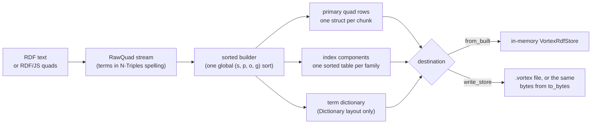
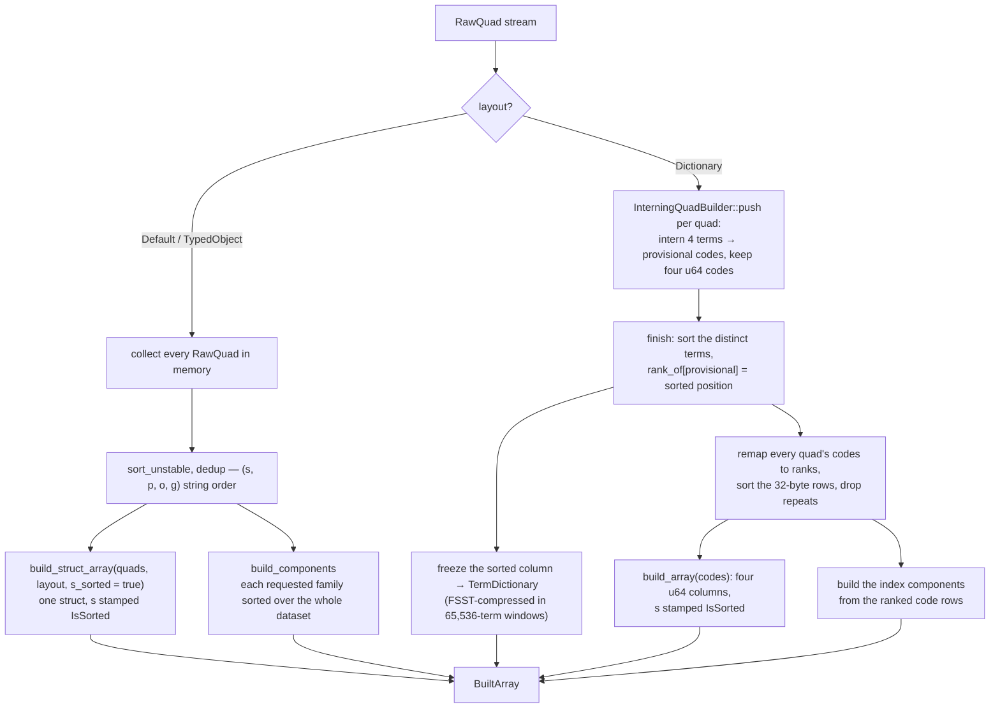
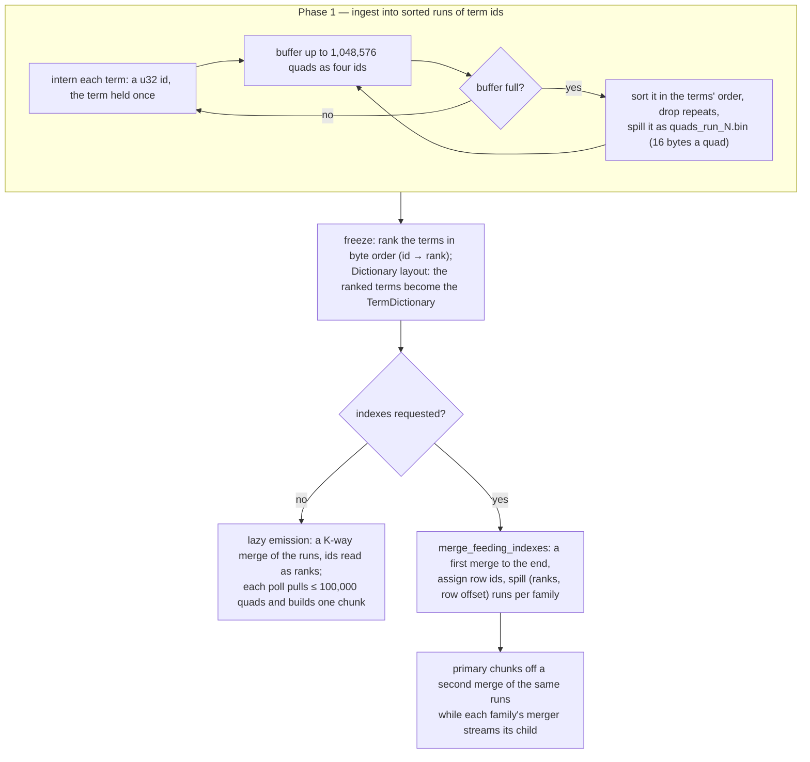
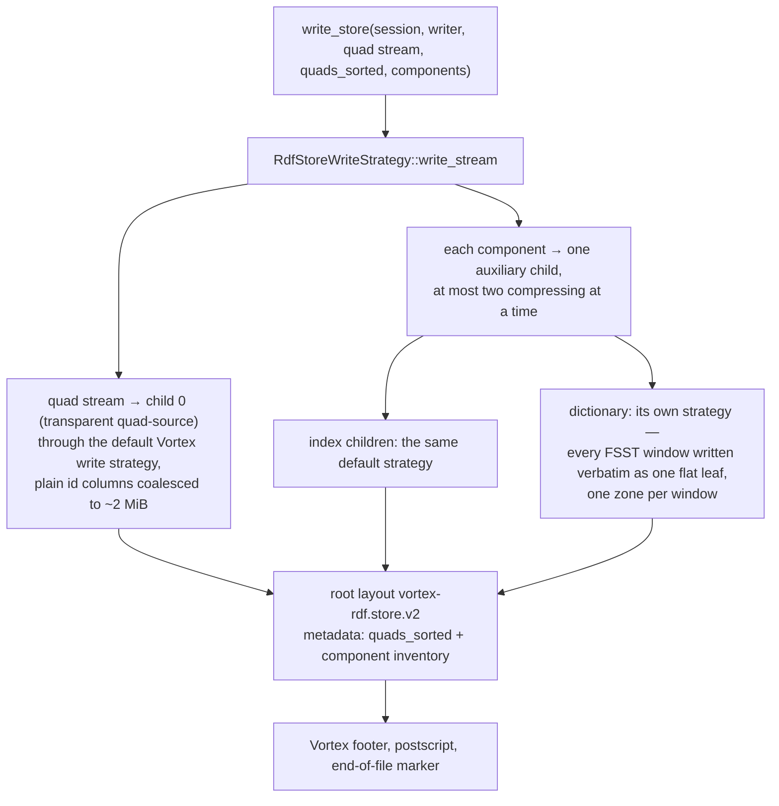

# How a store is built and written

This document traces what runs when RDF quads become a `VortexRdfStore` or a
`.vortex` file: the ingest currency, the two sorting pipelines, how each column
layout and secondary index takes shape, and how the parts are assembled into the
native container. What the resulting file looks like on disk is the subject of
[file-format.md](file-format.md); how a store is queried is
[matching.md](matching.md).

---

## 1. What a build produces

Every build path — whichever binding it starts from and whichever pipeline it
runs — ends in the same three parts, and every destination consumes exactly
those parts:

| Part | In memory | In a file |
|---|---|---|
| Primary quad rows | one `StructArray` in the store's compressed-resident form ([§10](#10-adopting-a-build-in-memory)) | the transparent `quad-source` child of the store root |
| Index components | `IndexComponent`s held beside the base | one auxiliary child per family (`index:posg`, `index:ref-o`, …) |
| Term dictionary | a `TermDictionary` inside the resolved layout | the required `dictionary` child |

A builder hands these back in one of two shapes
([`BuiltArray`](../core/src/store/builders/mod.rs#L96) and the crate-private
[`BuiltStream`](../core/src/store/builders/mod.rs#L110)):

- **`BuiltArray`** — everything materialized: the quad array, the components,
  the dictionary. What `VortexRdfStore::from_built` adopts.
- **`BuiltStream`** — the schema dtype, a *lazy* stream of primary chunks, the
  components as writable sources, the dictionary, and the `quads_sorted`
  provenance the writer records. What the container writer drives.

---

## 2. Entry points

| Surface | Call | Pipeline | Produces |
|---|---|---|---|
| CLI | `vortex-rdf-cli serialize -i in.ttl -o out.vortex [--layout <default\|typed-object\|dictionary>] [--indexes secondary-by-copy] [--indexes secondary-by-reference] [-f <format>]` (`--layout` defaults to `dictionary`; [`SerializeArgs`](../cli/src/main.rs#L33)) | out-of-core | file |
| Rust | [`io::quads_stream_to_vortex_file`](../core/src/io/write.rs#L139) / [`quads_stream_to_vortex_writer`](../core/src/io/write.rs#L47) | out-of-core | file / any `VortexWrite` |
| Rust | [`VortexRdfStore::from_quads`](../core/src/store/construct.rs#L66), or [`SortedStreamBuilder::build_vortex_array`](../core/src/store/builders/sorted_stream.rs#L63) / [`SortedInMemoryBuilder::build_vortex_array`](../core/src/store/builders/sorted_in_memory.rs#L33) then [`VortexRdfStore::from_built`](../core/src/store/construct.rs#L112) to name the builder | either | in-memory store |
| Rust | [`VortexRdfStore::to_bytes`](../core/src/store/persist/serialize.rs#L133) | — (re-serializes a store; one opened from a file and left untouched copies the file) | bytes |
| Rust | [`VortexRdfStore::from_file_in_memory`](../core/src/store/persist/open.rs#L248) | — (reads a `.vortex` file whole, then adopts it in memory) | in-memory store |
| Python | `serialize_rdf(input_path, output_path, *, format=None, layout="dictionary", indexes=[])` ([`serialize_rdf`](../python/src/serialize.rs#L33)) | out-of-core | file |
| Python | `VortexRdfStore(path, in_memory=True)` | — (calls `from_file_in_memory`) | in-memory store |
| Python | `store.to_bytes()` / `VortexRdfStore.from_bytes(data)` | — | bytes |
| JavaScript | `VortexRdfStore.fromQuads(quads \| Stream<Quad>, {layout, indexes})`, `fromString(text, format, options)` ([`fromString`](../js/src/store.rs#L180-L181)), `serializeRdf(text, format, options)` ([`serializeRdf`](../js/src/lib.rs#L39-L40)) | in memory (the only pipeline compiled to wasm) | in-memory store / bytes |
| JavaScript | `store.toBytes()` / `VortexRdfStore.fromBytes(bytes)`; `deserializeRdf(bytes, format)` ([`deserializeRdf`](../js/src/lib.rs#L53-L54)) writes RDF text back | — | bytes |

Every surface defaults to the `dictionary` layout (the CLI's `--layout`,
Python's `layout=`, and the JavaScript `BuildOptions`
([`options.rs`](../js/src/options.rs#L21 "LayoutStrategy::Dictionary"))) and spells layouts and indexes with
the same kebab-case names, which `LayoutStrategy`/`IndexType` parse and print.

---

## 3. The ingest currency: `RawQuad`

Every builder consumes one thing: a stream of
[`RawQuad`](../core/src/common/quad.rs#L65)s, four owned strings in the exact
form the columns store.

| Field | Spelling | Example |
|---|---|---|
| `s` | `<iri>` or `_:id` | `<http://example.org/alice>` |
| `p` | `<iri>` | `<http://xmlns.com/foaf/0.1/name>` |
| `o` | `<iri>`, `_:id`, `"lit"`, `"lit"@lang`, `"lit"^^<dt>` | `"Alice"` |
| `g` | `<iri>`, `_:id`, or **`""` for the default graph** | `""` |

`RawQuad`'s ordering is lexicographic over the four strings, `s` first — this
is the `(s, p, o, g)` order every build sorts by. IRIs are spelled directly;
literals go through `oxrdf`'s `Display`, which escapes them.

Where the stream comes from:

- **RDF text** — [`parse_quads_from_reader`](../core/src/common/terms.rs#L355)
  drives an `oxrdfio` parser and converts each parsed quad on the spot, so no
  second copy of the terms outlives the conversion. Formats: N-Triples,
  N-Quads, Turtle, TriG, N3, RDF/XML, JSON-LD — named through
  [`format_from_name`](../core/src/common/formats.rs#L43) (`"nt"`, `"ttl"`,
  `"xml"`, …) or detected from the file extension.
- **RDF/JS quads** ([`ingest.rs`](../js/src/ingest.rs)) — an array is packed
  host-side into one length-prefixed buffer per 65,536 quads and decoded inside
  wasm; an RDF/JS `Stream<Quad>` is drained through its `data`/`end`/`error`
  events into a channel. Under the Dictionary layout an array goes straight
  into the interning sink ([§5](#5-pipeline-a--sorted-in-memory)), so no
  per-quad strings accumulate. Both shapes build each term through the same
  validated constructors ([`terms.rs`](../js/src/terms.rs)), so they accept
  and reject the same quads.

**A built store holds each quad once and each term once, in canonical form.**
Every source above reaches the builders through `oxrdf` values, which render
one spelling per RDF term — `"x"^^xsd:string` and `"x"` are the same
`RawQuad` string, a `\u` escape is resolved, a language tag is lower-cased
(`@EN` becomes `@en`) — so interning a spelling interns the term. Both
pipelines then drop repeated quads straight after sorting, before any row id
or index child is derived, so the rows and every index describe the same
deduplicated dataset (an RDF dataset is a set: a quad is in it or is not).
The rebuilds of [§11](#11-rebuilds-mutated-stores-compaction-export) do the
same. Builders do not parse a term again, so a build's input must come from
one of the canonical sources: `RawQuad::from_quad` (an `oxrdf` quad), the
parser, or [`RawQuad::canonical`](../core/src/common/quad.rs#L90), which
turns four strings into a `RawQuad` and rejects what is no quad (a literal
subject, a malformed IRI). A `RawQuad` written by hand in some other spelling
of the same terms is a different quad.

---

## 4. Sorting is not a knob

Both pipelines put the rows in global `(s, p, o, g)` order. Which pipeline runs
is a property of the target
([`builders/mod.rs`](../core/src/store/builders/mod.rs#L9 "Which pipeline runs")):

| Target | Builder | Holds |
|---|---|---|
| Anywhere with a filesystem (Rust, CLI, Python) | `SortedStreamBuilder` — external merge sort | the distinct terms and one chunk of quads, plus spill runs of term ids on disk |
| `wasm32-unknown-unknown` (JavaScript) | `SortedInMemoryBuilder` — one in-memory sort; the only builder compiled there | the whole dataset |

The order is what the read side is written against: the `s` column carries the
`IsSorted` stamp, which the store trusts as the witness of the whole
`(s, p, o, g)` order ([matching.md §6.1](matching.md#61-prefix-probe)); the
index children are globally sorted, which is what makes them binary-searchable;
and the file's root metadata records `quads_sorted` so a reader can restore the
stamp on rows it materializes. The sort is also where repeated quads are
dropped ([§3](#3-the-ingest-currency-rawquad)): equal quads are adjacent in
the order, and each distinct quad leaves it once.

---

## 5. Pipeline A — sorted in memory

[`SortedInMemoryBuilder`](../core/src/store/builders/sorted_in_memory.rs)
holds everything and sorts once. It has two shapes, because the Dictionary
layout can do better than sorting strings.

**String layouts.** The stream is drained into a `Vec<RawQuad>`, sorted, stripped
of its adjacent repeats, and built into one struct of primary columns through
[`build_struct_array`](../core/src/store/builders/mod.rs#L172); the requested
index families are sorted over that same vector ([§8](#8-secondary-indexes-at-build-time)).

**Dictionary layout.** Terms are interned as they arrive
([`InterningQuadBuilder`](../core/src/store/layouts/dictionary/ingest.rs#L137)):
each distinct term is held once (a `Box<str>` keyed map), and each quad is kept
as four provisional `u64` codes. `finish` sorts the distinct terms, freezes them
into the dictionary, replaces every provisional code by its term's sorted rank —
which *is* the dictionary code — and sorts the coded rows. Because codes are
lexicographic ranks, sorting `[u64; 4]` rows is the same order as sorting the
term strings, so the sort moves 32-byte rows instead of four-string structs;
equal rows are then adjacent and the repeats are dropped, since equal codes are
equal terms.
[`DictionaryQuadSink`](../core/src/store/layouts/dictionary/ingest.rs#L101) is
the push-based form of the same ingest, for callers that produce quads one at a
time (the wasm array path).

---

## 6. Pipeline B — sorted out of core

[`SortedStreamBuilder`](../core/src/store/builders/sorted_stream.rs#L60) is an
external merge sort over term ids: peak memory is bounded by the dataset's
distinct terms plus a run buffer and a chunk, not by the dataset, and the
spill holds each quad once, as 16 bytes.

**Phase 1 — runs.** Every term is interned as it arrives, under every layout
([`TermInterner`](../core/src/store/builders/interner.rs#L36)): each distinct
term is held once under a provisional `u32` id, in arrival order, and a quad is
kept as its four ids. The buffer holds up to
[`DEFAULT_RUN_ROWS`](../core/src/store/builders/mod.rs#L54) (1,048,576) quads,
16 bytes each; a buffer that would overflow is sorted in its terms' order (an
equal id is an equal term, never read), deduplicated and spilled as one run
([`QuadSpiller`](../core/src/store/builders/runs.rs#L262)). A dataset that fits
in a single buffer never touches the filesystem — the sorted buffer *is* the
run. The distinct terms are the one thing this pipeline holds for the
dataset's lifetime: in the interner during ingest, then as the Dictionary
layout's term dictionary or, under the string layouts, as the sorted terms the
ranks are spelled back from. A build of more than `i32::MAX` distinct terms is
refused at the term past it.

**Freeze.** The interner's
[`finish`](../core/src/store/builders/interner.rs#L117) sorts the terms once, in
byte order, and maps each id to its term's rank. A rank keeps its term's order
— the order of dictionary codes and of `RawQuad`'s derived `Ord` — so a run
sorted by its terms is sorted by rank tuple once its ids are read as ranks: no
run is sorted again. Under the Dictionary layout the ranked terms become the
term dictionary (a rank's code is its position), each term moved into the
column and freed as it is copied.

**Phase 2 — merge.** A binary heap holds the head of every run, its ids read
as ranks (a lone run is read straight through); popping it yields the globally
next quad in `(s, p, o, g)` order. The quads come out *distinct*: a run drops
its repeats as it is sorted, and equal quads are adjacent in the merged order,
so the merge skips any quad equal to the one it emitted last, and a quad that
arrives more than once, in one run or in several, is emitted once. Row ids are
assigned after this, so the index families' records, spilled and merged the
same way, are unique because their row ids are: none equals the one before
it.

**Phase 3 — emission.** Without indexes the merge is lazy
([`build_chunk_stream`](../core/src/store/builders/sorted_stream.rs#L229)):
every poll pulls up to a chunk's worth of quads off the heap and builds one
struct, their ranks spelled as dictionary codes
([`build_code_chunk`](../core/src/store/layouts/dictionary/codec/mod.rs#L106)) or,
under the string layouts, as their terms again
([`build_struct_array`](../core/src/store/builders/mod.rs#L172)). With indexes a
first merge runs to completion
([`merge_feeding_indexes`](../core/src/store/builders/stream_indexes.rs#L115)):
row ids are only known as the merge assigns them, and an index child is a
*globally* sorted table over those ids, so it needs a second external sort.
Each merged quad's ranks are pushed into one spiller per requested family
([`EntrySpiller`](../core/src/store/builders/runs.rs#L494)), each spilling its
own sorted runs:

| Family | Spilled entry | Run files |
|---|---|---|
| `index:ref-o` / `index:ref-p` | `(rank, row id)` | `idx_o_run_N.bin`, `idx_p_run_N.bin` |
| `index:posg` / `index:ospg` | `(four ranks in the family's key order, row id)` | `idx_posg_run_N.bin`, `idx_ospg_run_N.bin` |

The primary chunks then come off a second merge of the same quad runs, while
each family's merger streams its child's chunks in global order through a
pull-based component source, the ranks spelled as the layout's terms as each
chunk is built — no index is ever materialized whole, and the quads are never
written a second time.

**Spill files** are fixed-width little-endian records
([`runs.rs`](../core/src/store/builders/runs.rs)) in a per-build run
directory, removed when the stream is dropped:

| Run | Header | Record |
|---|---|---|
| `quads_run_N.bin` | none | four `u32` term ids: 16 bytes |
| `idx_o_…`, `idx_p_…` | the run's first row id, `u64` | rank `u32`, row offset `u32`: 8 bytes |
| `idx_posg_…`, `idx_ospg_…` | the run's first row id, `u64` | four ranks `u32`, row offset `u32`: 20 bytes |

A run holds at most `DEFAULT_RUN_ROWS` entries numbered consecutively (one per
quad, in row order), so a row offset from the run's first row id fits a `u32`.
The spill peaks at the end of the first merge, when the quad runs and every
index run exist at once: 16 bytes a quad, plus 16 for the reference index and
40 for the copy index (plus 8 bytes a run). A record cut off partway, or an id
or rank past its table, is a `Deserialization` error.

A build that writes a file names the directory after
that file (where the links at its path end), `.<file name>.spill-<uuid>`
(`.out.vortex.spill-<uuid>` for `out.vortex`), by default a hidden sibling of
the store, so a directory a crash left behind says which output it belonged
to; a build with no output path (an in-memory store, or
[`quads_stream_to_vortex_writer`](../core/src/io/write.rs#L47) into a caller's
writer), or one whose file name would make the directory's name longer than
255 bytes, uses `.vortex-rdf.spill-<uuid>`. The parent directory is resolved in
this order ([`TempRunsGuard::create`](../core/src/store/builders/spill.rs#L99)):
the `VORTEX_RDF_SPILL_DIR` environment variable, a caller-supplied base (a
serialization to a file,
[`quads_stream_to_vortex_file`](../core/src/io/write.rs#L139) and so the CLI
and Python's `serialize_rdf`, and a compaction both pass the directory of
their temp file: beside the file they write or replace, links followed, on the
volume that takes the store), then the OS temp dir (a build with no output
path, or one writing into a character device or a pipe). A spill write that
fails reports the directory it failed in and suggests setting
`VORTEX_RDF_SPILL_DIR` to a directory with more room (the volume or a quota is
full) or to a writable directory (any other failure).

| Build | Peak memory |
|---|---|
| no indexes | the distinct terms (the interner during ingest, then the term dictionary, or the sorted terms under the string layouts) + a run buffer of up to 1,048,576 quads (16 MB) + heap heads + one chunk |
| with indexes | as above, plus each family spiller's buffer of up to 1,048,576 entries (16 MB a reference spiller, 24 MB a copy spiller), plus the components' compressed segments the writer holds until the quad table finishes ([`write_stream`](../core/src/io/container/write.rs#L94)) |

---

## 7. Columns, per layout

The layout decides what a `RawQuad` becomes ([`LayoutStrategy`](../core/src/store/layouts/mod.rs#L52)).
Every layout puts `s` first and stamps it when the rows are sorted.

| Layout | Columns | Term encoding |
|---|---|---|
| `Default` | `s`, `p`, `o`, `g` — non-nullable `Utf8` | the N-Triples strings, verbatim |
| `TypedObject` | `s`, `p`, `o_kind` (`u8`), `o_value` (`Utf8`), `o_datatype` (nullable `Utf8`), `o_lang` (nullable `Utf8`), `g` | as `Default`, with the object decomposed |
| `Dictionary` | `s`, `p`, `o`, `g` — non-nullable `u64` | codes into one sorted dictionary |

**TypedObject decomposition** ([`decompose_object`](../core/src/store/layouts/typed_object.rs#L66)):

| `o_kind` | Object | `o_value` | `o_datatype` | `o_lang` |
|---|---|---|---|---|
| 0 | IRI | the IRI | null | null |
| 1 | blank node | the id | null | null |
| 2 | plain literal (`xsd:string`) | the value | null | null |
| 3 | language-tagged literal | the value | null | the tag |
| 4 | typed literal | the value | the datatype IRI | null |

**The dictionary** ([`term_dict.rs`](../core/src/store/layouts/dictionary/term_dict.rs))
is the sorted set of every distinct term of the dataset — subjects, predicates,
objects and graph names in one namespace, the default graph's `""` included. A
term's code is its position, so code order equals string order and a bound
term resolves to its code by binary search. The frozen column is
FSST-compressed at the source ([`compress`](../core/src/store/layouts/dictionary/storage/mod.rs#L242)):
one symbol table is trained on the whole column and the terms are compressed in
independent windows of [`DICT_CHUNK_ROWS`](../core/src/store/layouts/dictionary/storage/mod.rs#L36)
(65,536) terms, each window a self-contained FSST array. The term count must
fit an `i32`.

Which pipeline built the dictionary decides how a term reaches its code during
encoding: a rebuild looks it up in a term→code map borrowed from the live quads
([`from_quads_with_map`](../core/src/store/layouts/dictionary/ingest.rs#L62)),
while the interning builds never look a term up again: their quads hold term
ids, remapped to ranks, and a rank's code is its position. Either way the
mapping exists only for the build; stores keep the columnar dictionary alone.

---

## 8. Secondary indexes at build time

Indexes never ride inside the quad rows: a builder emits primary-only rows plus
one *component* per requested family, and that is the only form index data ever
takes — in memory as an [`IndexComponent`](../core/src/store/indexes/components.rs#L120),
in a file as an auxiliary child.

| Index | Children | Columns | Sorted by |
|---|---|---|---|
| `secondary-by-copy` | `index:posg`, `index:ospg` | `s`, `p`, `o`, `g`, `rid` | `(p, o, s, g)` and `(o, s, p, g)` |
| `secondary-by-reference` | `index:ref-o`, `index:ref-p` | `val`, `rid` | `val`, then `rid` |

Term columns use the layout's encoding — strings under `Default` and
`TypedObject` (a `TypedObject` object is recomposed to its full N-Triples term
for the index), `u64` codes under `Dictionary` — and `rid` is always the `u64`
position of the quad in the sorted primary rows
([`RowId`](../core/src/store/schema.rs#L33)).

**Row ids never wrap.** A `u64` row id numbers more rows than any store holds,
so row ids do not limit a store. Every build still numbers rows with checked
arithmetic and refuses a store whose ids would run past the last one, rather
than let an id wrap onto row 0:

| Where | Check | Refusal |
|---|---|---|
| in-memory builds, compaction's in-memory rebuild, `to_bytes` of a store with a tail | the row count, before any id is assigned ([`check_indexed_rows`](../core/src/store/indexes/mod.rs#L108)) | `Serialization`: the store *would exceed* `u64::MAX` quads |
| the out-of-core merge, a file-backed compaction | each row as the merge numbers it ([`next_row_id`](../core/src/store/indexes/mod.rs#L122)); a refused file build leaves no file | the same |

Opening a file whose index children record row ids of another width is
refused with a deserialization error that says to rebuild the store
([file-format.md §6](file-format.md#6-the-index-children)).

**In memory** ([`build_components`](../core/src/store/builders/mod.rs#L198)) each
family is a permutation of the complete sorted dataset: sort the row ids by the
family's comparator ([`CopyFamily::cmp_quads`](../core/src/store/indexes/copy.rs#L138),
or the code tuple under Dictionary), then gather the columns through that
permutation — the permutation itself is the `rid` column. The lead sort column
is stamped `IsSorted`.

**Out of core**, the same tables come off the spill-run mergers of
[§6](#6-pipeline-b--sorted-out-of-core), a chunk at a time.

Both hand the child over with `sorted: true` provenance, because both sorted
the whole dataset; a reader binary-searches a child on that flag alone
([matching.md §8](matching.md#8-the-index-resolvers)).

---

## 9. Writing the container

Whatever produced the parts, one function writes them:
[`write_store`](../core/src/io/container/write.rs#L159). It installs the store's
own write strategy, [`RdfStoreWriteStrategy`](../core/src/io/container/write.rs#L63),
on a stock Vortex file write:

- **The quad table** goes through [`child_strategy`](../core/src/io/container/sources.rs#L153)
  — Vortex's default `WriteStrategyBuilder` pipeline: split the struct into
  columns, repartition each column into 8,192-row blocks, compute zoned
  statistics per block, dictionary-encode a column where sampling says it pays,
  coalesce chunks toward ~1 MiB segments, compress each chunk with the
  BtrBlocks-style compressor, and write flat leaf layouts. Each id column —
  a `u64` term-code `s`, `p`, `o`, `g` or `val`, or a `u64` row-id `rid` —
  is handed, through the builder's per-field override, to
  [`id_column_strategy`](../core/src/io/container/sources.rs#L213): the same
  per-column pipeline rebuilt step for step from Vortex's layout strategies,
  with the coalescing target split in two. A column that does not
  dictionary-encode coalesces toward ~2 MiB, 262,144 rows per leaf for a
  plain `u64` id column; a dictionary's codes, as narrow as its cardinality
  needs, stay at ~1 MiB. A test pins the
  copy to Vortex's pipeline: at 1 MiB for both targets it must write the
  stock bytes. A table without id columns — the string layouts' quad
  table — gets the stock pipeline unchanged
  ([`default_child_strategy`](../core/src/io/container/sources.rs#L135)).
- **Index children** take exactly the same strategy, so their encoding is what a
  plain table write produces: plain code columns and `rid` (row ids are
  unique, so never dictionary-encoded) at ~2 MiB, dictionary codes at ~1 MiB,
  term strings under the string layouts at ~1 MiB.
- **The dictionary** takes [`dict_child_strategy`](../core/src/io/container/sources.rs#L290):
  its chunks are already FSST-compressed windows, so they are written verbatim
  as one flat leaf each under a chunked node — no sampling, no re-encoding —
  zoned one zone per window with the window's exact first and last term when
  the windows are uniform. The leaves are the windows a file-backed dictionary
  reads, and the zone table its window bounds
  ([file-format.md §5](file-format.md#5-the-dictionary-child)).
- **Ordering.** The quad stream owns the first sequence subtree and each
  component an ordered sibling subtree, so the quad table's segments land ahead
  of every component's, in inventory order; the descriptors and `quads_sorted`
  are encoded into the root layout's metadata ([file-format.md §3](file-format.md#3-the-store-root-vortex-rdfstorev2)).
- **Provenance.** `quads_sorted` is read off the primary's own `s` stamp when a
  store re-serializes ([`into_stream`](../core/src/store/persist/serialize.rs#L27)) and is
  `true` by construction for a builder's stream; each component's `sorted` flag
  travels on its descriptor.

One driver feeds this, [`built_stream_to_vortex_writer`](../core/src/io/write.rs#L78):
a builder's chunk stream (files, compaction; a file is written through a
[`PendingStore`](../core/src/io/pending.rs#L77) beside its path and renamed
into place, so a failed write leaves no partial file and the previous store
untouched, and on Unix a store that has the old file mapped keeps reading
it), or a store's split parts as one chunk
([`into_stream`](../core/src/store/persist/serialize.rs#L27): `to_bytes`, the
bindings' exchange bytes). On the wire the two are the same container.

**Replacing a file.** [`PendingStore`](../core/src/io/pending.rs#L77) is the one
way a store reaches a path. `create` makes `<store>.write-<uuid>.tmp` beside
the file it replaces *before* any input is read or any row gathered, so a
path that cannot take a store (a missing directory, no permission to write
there, a directory at the path, a store the process cannot write) is
reported at once, by a serialization and by a compaction alike; then the
build fills the temp file and `write` renames it over the old one. What the
old file was set up as is kept:
a symbolic link at the path (or a chain of them) is followed and the file it
ends at is replaced, so a `current -> versions/v3.vortex` setup keeps its
link; the temp file for an existing store is created private (`0600` on Unix,
whatever the umask) and the old file's permission bits are set on it before
the first byte is written, so no byte of a private store is ever in a file
others can read (a path with no store yet gets the permissions any new file
does); a path that resolves to a character device or a pipe (`/dev/null`,
`/dev/stdout` behind a pipe) takes the store in place, with no temp file and no
all-or-nothing guarantee, and any other file that is not a regular file is
refused; a filesystem that refuses that `chmod` fails the write, with the temp
file removed and the old store untouched; and a store the process cannot write is
never replaced (a read-only store signals that it should not be overwritten:
the rebuild fails with `PermissionDenied`, or the read-only filesystem's error,
before anything is built, and compaction of such a file fails the same way; an
append's auto-compaction alone does not fail, it keeps the batch in the
in-memory tail, see [mutations.md §5.1](mutations.md#51-auto-compaction)).
Owner, ACLs and extended attributes are **not** preserved: the new file
belongs to the process that wrote it, and it has a new inode, so another hard
link to the old file keeps the old store. Two costs follow from the design: a
rebuild needs a **writable directory** (a writable file in a read-only
directory cannot be rebuilt), and about **twice the disk space** while the old
and the new file coexist (the old file's blocks are freed once the last store
mapping it is dropped). The swap is atomic against a process crash, not
durable against power loss: nothing is `fsync`ed before the rename, so a power
failure right after it can leave a short file on a filesystem that does not
order a file's data before the rename. A process killed while it builds or
writes (`SIGKILL`, a power failure) leaves its `<store>.write-<uuid>.tmp`
beside the store, and nothing removes it later. And on
Windows the rename is refused while a store has the old file mapped, so a
rebuild over a mapped path fails until that store is closed; on Unix the old
inode stays alive for the mapping.

---

## 10. Adopting a build in memory

A build that is queried in place, without a file, skips the writer:
[`from_built`](../core/src/store/construct.rs#L112) turns a `BuiltArray` into the
store's *compressed-resident* form (through
[`adopt`](../core/src/store/construct.rs#L125), the step it shares with
`from_parts`):

- every non-nullable `u64` code child and row-id child of the base and of
  each component is re-encoded from the bounds the build already
  knows —
  `Constant` for a single-valued column, `RunEnd` for a sorted column with few
  runs, bit-packed at the observed width otherwise
  ([`with_compressed_int_children`](../core/src/store/resident.rs#L77)); the
  `IsSorted` stamps carry across;
- the base's compressed columns are wrapped in a `vortex.shared` node, so the
  match fast paths probe the compressed source while the code-column payload
  path decodes the canonical primitive once into the wrapper's cache;
- the encoded-search probes over every column are resolved up front
  ([`StructProbes::warm`](../core/src/store/probes.rs#L36)), so no query pays the
  encoding-tree walk;
- the smallest and largest code of each 8,192-row zone of every code column
  is taken in the pass that picks the column's encoding, which reads every
  code for the column's own bounds anyway
  ([`ZoneBuilder`](../core/src/store/zones.rs#L79)): the in-memory
  counterpart of a file's zone maps, so a match's residual equality compares
  only the zones that may hold its code
  ([matching.md §6.3](matching.md#63-residual-column-filtering)).

The other in-memory adoption, [`from_parts`](../core/src/store/construct.rs#L95)
(crate-private; `from_file_in_memory` calls it), takes a store's split parts:
it keeps each integer child's existing encoding wherever a probe binds it and
decodes only the ones that decline. Its zone bounds are the file's own zone
maps, read at open ([`ZoneTable::read_from_file`](../core/src/store/zones.rs#L151)),
as `from_bytes` reads them. Opening serialized bytes in memory is
[file-format.md §8](file-format.md#8-reading-a-file).

---

## 11. Rebuilds: mutated stores, compaction, export

A store never rewrites its base to answer a mutation: appends accrete in a
`Tail`, deletes set tombstone bits ([`mutation.rs`](../core/src/store/write/mutation.rs);
the model is [mutations.md](mutations.md)). Serialization and compaction are
where those layers are folded back into the three parts of
[§1](#1-what-a-build-produces).

### 11.1 Serializing a store (`to_bytes`, `to_serializable_parts`)

A store opened from a mapped file (`from_file`) and left untouched — no
pushed-down filter, an all-rows selection, no tombstone and no tail — *is*
that file, so `to_bytes` copies the mapped bytes as they are: no row is read,
no part rebuilt, no compression run, and the copy reads back as the file
does, unknown children included. Any other store is written from its parts.

[`to_serializable_parts`](../core/src/store/persist/serialize.rs#L88) decides what a view's
parts are:

| The view is… | Rows | Components | Dictionary |
|---|---|---|---|
| a pristine owner (no tail, no tombstones) | its base, as held | passed through; a file view lifts its index children | the store's own |
| tailed, or tombstoned with indexes | live base rows + live tail rows, **re-sorted** into `(s, p, o, g)` order | **rebuilt** over the merged rows | **fresh** under Dictionary — the tail may hold terms the old dictionary never coded |
| narrowed (a `match_pattern` result) | its selected rows only | none — its rows are renumbered, and rebuilding indexes for an arbitrary view is compaction's job | the store's own |

The re-sort ([`sorted_live_raw_quads`](../core/src/store/write/compaction.rs#L87),
the one compaction runs too) sorts the small tail alone and merges it into the
already-sorted base in a linear pass; only a base that never carried the stamp
pays a full sort. The written artifact therefore always claims `quads_sorted`
truthfully. The sorted rows are then deduplicated, as every builder's output
is, so the artifact holds each quad once even when the rows it was gathered
from did not.

### 11.2 Compaction

`compact` and `compact_with_indexes` gather every live quad, sort and drop
repeated quads exactly as a serialization's rebuild does (§11.1), and rebuild the
base and its indexes from them. How a file-backed owner rewrites its file, how an
in-memory store rebuilds and when `add_quads` compacts by itself are in
[mutations.md §5](mutations.md#5-compaction).

### 11.3 Back to RDF text

The reverse direction is [`export_rdf`](../core/src/store/persist/export.rs#L27) (the
CLI's `deserialize`, the bindings' `toRdf`): N-Triples and N-Quads are written
straight from the raw term columns — the strings *are* the serialization — while
every other format decodes to `oxrdf` terms and drives the `oxrdfio` serializer.

---

## 12. Knobs

| Knob | Where | Default | Effect |
|---|---|---|---|
| `--layout` / `layout` | every surface | `dictionary` | column layout ([§7](#7-columns-per-layout)) |
| `--indexes` / `indexes` | every surface | none | which index families to build ([§8](#8-secondary-indexes-at-build-time)) |
| `VORTEX_RDF_SPILL_DIR` | environment | unset (caller base, else OS temp) | where spill runs live |

The sizes a build uses (`DEFAULT_CHUNK_ROWS`, `DICT_CHUNK_ROWS`, the row block and
the segment target) are constants, tabulated in [file-format.md §11](file-format.md#11-constants).

---

## 13. Source map

| Concern | File |
|---|---|
| `RawQuad`, text parsing, format names | [`core/src/common/quad.rs`](../core/src/common/quad.rs), [`terms.rs`](../core/src/common/terms.rs), [`formats.rs`](../core/src/common/formats.rs) |
| Builder contract, `BuiltArray`/`BuiltStream`, `build_struct_array`, `build_components` | [`core/src/store/builders/mod.rs`](../core/src/store/builders/mod.rs) |
| In-memory sort | [`core/src/store/builders/sorted_in_memory.rs`](../core/src/store/builders/sorted_in_memory.rs) |
| External merge sort, index spill mergers and their pull-based component source | [`core/src/store/builders/sorted_stream.rs`](../core/src/store/builders/sorted_stream.rs), [`stream_indexes.rs`](../core/src/store/builders/stream_indexes.rs), [`spill.rs`](../core/src/store/builders/spill.rs) |
| Layout columns | [`core/src/store/layouts/default.rs`](../core/src/store/layouts/default.rs), [`typed_object.rs`](../core/src/store/layouts/typed_object.rs), [`dictionary/codec/mod.rs`](../core/src/store/layouts/dictionary/codec/mod.rs) |
| Dictionary construction, interning, FSST windows | [`core/src/store/layouts/dictionary/ingest.rs`](../core/src/store/layouts/dictionary/ingest.rs), [`storage/mod.rs`](../core/src/store/layouts/dictionary/storage/mod.rs) |
| Index children | [`core/src/store/indexes/copy.rs`](../core/src/store/indexes/copy.rs), [`reference.rs`](../core/src/store/indexes/reference.rs), [`components.rs`](../core/src/store/indexes/components.rs) |
| Write driver and entry points, a store file's atomic replacement at its path | [`core/src/io/write.rs`](../core/src/io/write.rs), [`pending.rs`](../core/src/io/pending.rs) |
| Container write strategy, component sources, wire metadata | [`core/src/io/container/write.rs`](../core/src/io/container/write.rs), [`sources.rs`](../core/src/io/container/sources.rs), [`wire.rs`](../core/src/io/container/wire.rs) |
| In-memory adoption, compressed-resident form | [`core/src/store/construct.rs`](../core/src/store/construct.rs), [`resident.rs`](../core/src/store/resident.rs), [`probes.rs`](../core/src/store/probes.rs) |
| Serialization of mutated stores, compaction, mutation policy ([mutations.md](mutations.md)) | [`core/src/store/persist/serialize.rs`](../core/src/store/persist/serialize.rs), [`write/compaction.rs`](../core/src/store/write/compaction.rs), [`write/mutation.rs`](../core/src/store/write/mutation.rs) |
| Export to RDF text | [`core/src/store/persist/export.rs`](../core/src/store/persist/export.rs) |
| Bindings | [`cli/src/main.rs`](../cli/src/main.rs), [`python/src/serialize.rs`](../python/src/serialize.rs), [`js/src/store.rs`](../js/src/store.rs), [`js/src/ingest.rs`](../js/src/ingest.rs), [`js/src/options.rs`](../js/src/options.rs) |
